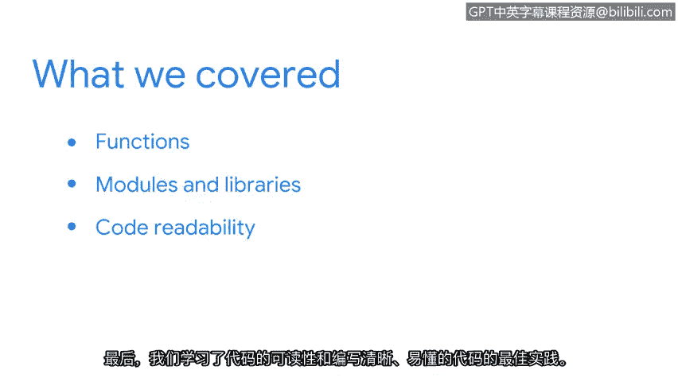

# 谷歌网络安全专业证书第七课：《用Python自动化网络安全任务》（中英字幕，前面分p中字，后面分p英字） - P22：21_总结.zh - GPT中英字幕课程资源 - BV1Dp4y1G759

Great work on making it this far in the Python course。

 You put in a lot of work and effort towards learning more about how you can use Python effectively and efficiently。

😊，Let's quickly re up the concepts you learned throughout the videos。First。

We started by understanding the role of functions in Python。They can save you a lot of time。

 You learn how to incorporate building functions and how to develop your own functions to meet your needs。

We then shifted our focus towards modules and libraries。

 which gave us access to a lot more functions than those built into Python。Lastly。

 we move to learning about code readability and best practices to write clean， understandable code。

With these understandings， you're ready to learn how powerful Python can really be for task automation。

And how it can help you going forward as a security analyst。

Thank you for taking the time to go through this course with me。 I'll meet you in the next videos。😊。

