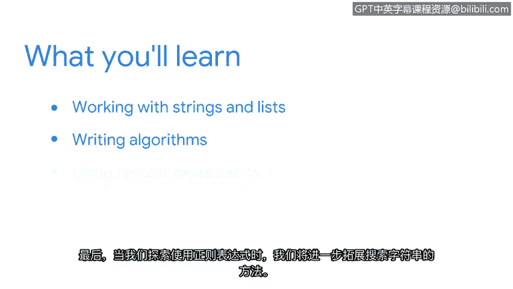

# 谷歌网络安全专业证书第七课：《用Python自动化网络安全任务》（中英字幕，前面分p中字，后面分p英字） - P23：22_欢迎来到第三周.zh - GPT中英字幕课程资源 - BV1Dp4y1G759

As a security analyst， you'll work with a lot of data。

Being able to develop solutions for managing these data is very important。

What we're about to learn in Python will help you with that。Previously。

 we set foundations for what we're going to do in this section。

We learned all about data types and variables。 we also covered conditional and iterative statements。

 we learned about building functions and even created our own functions。Here。

 we'll build on that in a few different ways。 First。

 you'll learn more about working with strings and lists。

Will expand the ways that you can work with these data types。

 including extracting characters from strings or items from lists。

Our next focus is on writing algorithms。You'll consider a set of rules that can be applied in Python to solve a security related problem。

 and finally， we'll further expand the ways we can search for strings when we explore using regular expressions。

We're going to have a lot of fun。 And you start writing some really interesting coding Python。😊。

I can't wait to get it started。