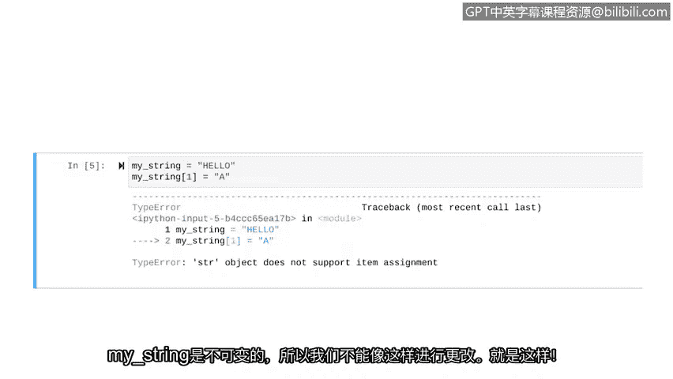

# 谷歌网络安全专业证书第七课：《用Python自动化网络安全任务》（中英字幕，前面分p中字，后面分p英字） - P25：24_Python中的字符串索引和切片.zh - GPT中英字幕课程资源 - BV1Dp4y1G759

In security， there are a variety of reasons we might need to search through a string。 For example。

 we might need to locate a username in a security log。

Or if we learn that a certain IP address is associated with malware。

We might search for this address in a networking log。

And the first step in being able to use Python in these ways is learning about the index of characters in a string。

The index is a number assigned to every element in a sequence that indicates its position。

In this video， we are discussing a strings。 So the index is the position of each character in a string。

Let's start with this string， hello。Every character in the string is assign an index In Python。

 we start counting indexdices from 0。 So the character H has an index of 0。

 and E has an index of1 and so on。Let's take this into Python and practice using indices。

Placing an index in a square brackets after a string returns the character at that index。

Let's place the index1 in square brackets after hello， and run it。This return the character， E。

Remember in this is a star at 0， so an index of one isn't the first character in the world。

But what if we wanted to return more than just one character。

We can extract a larger part of a string by specifying a set of indices。 And this is gold as lice。

When taking a lies from a string。We specify where the slice starts and where the slice ends。

 So we provide two indices。The first index is the beginning， which is included in the output。

The second index is the end， but it's not included in the final output。 Instead。

 Python stops the slice at the element before the second index。For example。

 if we wanted to take the letters E， L， L from hellello。

 we would start the interval from the index 1， but we'd end before the index 4。

Let's try this example and extract a slice from a stringing python。

Let's type in the string and take the slices starting at index 1 and ending before index 4 now。

Let's run the code， and examine the output。And there's the slice we wanted。

Now that we know how to describe the location of a character in a string。

Let's learn how to search in a string。To do this。We need to use the index method。

The index method finds the first occurrence of the input in a string and returns its location。

Let's practice using the index method in Python。Let's say we want to use the index method to find the character E in the string hello。

Will locate the first instance of the character E。Let's examine this line， in more detail。

After writing the string and the index method。We use the character we want to find as the argument of the index method。

Remember， a strengthing python are case sensitive。 so we need to make sure we use the appropriate case with the index method。

Let's run this code now。This return the number one。This is because E has an index value of1。Now。

 let's explore an example where a character repeats multiple times in the string。

Let's try searching for the character L。We start with similar code as before。

 passing the argument L instead of E to the index method。Now。

 let's run this code and investigate the result。The result is the index 2。

This tells us that the method only identified the first occurrence of the character L。

 and not the second。This is an important detail to notice when working with the index method。

As a security analyst， learning how to work with indices allows you to find certain parts in a string。

 For example， if you need to find the location of the a symbol in an email。

 you can use the index method to find what you're looking for with one line of code。Now。

 let's turn our attention to an important property of his strings。Have you ever heard the expression。

 some things never change。It might be said about the comfortable feeling you have with a good friend。

 even when you haven't seen them for a long time。Well， in Python， we can also say this about strings。

The strings are immutable。In Python， immutable means that it cannot be changed after it's created and assign a value。

Let's break this down with an example。Let's assign the string hello to the variable， my string。Now。

 if we want to change the character E to an A。 So my string has the value。H， A， L， L， O。

 then we might be inclined to use index notation。But here we get a error。My strength is immutable。

 so we cannot make changes like this。

And there you have it。 Do just learn how to index and slice into strings。

 You've also seen that the strings are immutable， so you cannot reassign characters after a string has been defined。

Coming up， we'll learn about list operations and see that lists。Can be changed with index notation。

Made you there。

