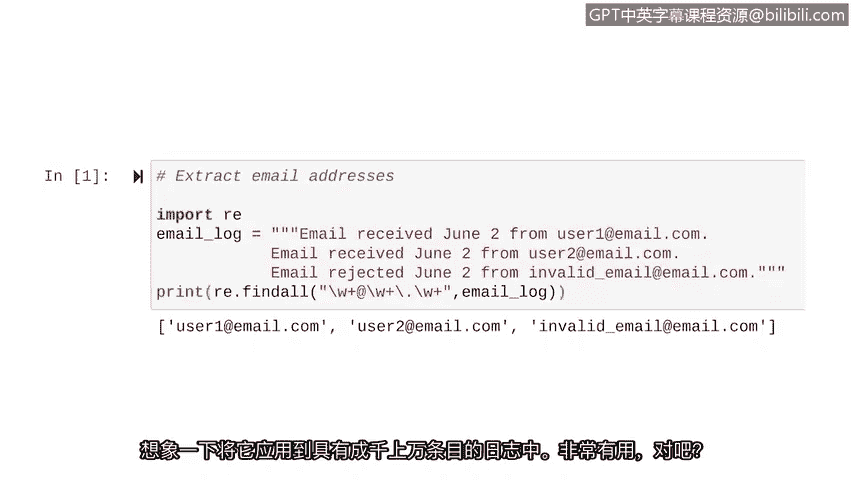

# 谷歌网络安全专业证书第七课：《用Python自动化网络安全任务》（中英字幕，前面分p中字，后面分p英字） - P28：27_Python中的正则表达式.zh - GPT中英字幕课程资源 - BV1Dp4y1G759

We've already learned a lot about working with strings。

This includes working with their positional indices， and analyzinglicing them。In the previous video。

 we applied these to extract the first three digits from a list of IP addresses。 In this video。

 we're going to focus on a more advanced way to search through strings。😊。

Well learn about searching for patterns in the strings， through regular expressions。

A regular expression shortened to reggx is a sequence of characters that forms a pattern。

This pattern can be used when searching within log files。

 We can use them to search for any kind of pattern。For example。

 we can find all strings that start with a certain prefix。

 or we can find all strings that are a certain length。

We can apply these to a security context in a variety of ways。For example。

Let's say we needed to find all IP addresses with a network I of 184。

Regular expressions would allow us to efficiently search for this pattern。

Willll examine another example throughout this video。

Let's say that we want to extract all the email addresses contained a log。

If we try to do this through the index method。We would need the exact email addresses we were searching for as security analysts。

 we rarely have that kind of information。But if we use a regular expression that tells Python how an email address is a structure。

You would return all the strings that have the same elements as an email address。

Even if we were given a log file with thousands of lines and entries。

We could extract every email in the file by searching for the structure of an email address through a regular expression。

We wouldn't need to know their specific emails to extract them。

Let's explore the regular expression symbols that we need to do this。To begin。

 let's learn about the plus sign。The plus sign is a regular expression symbol that represents one or more occurrences of a specific character。

Let's explain that through an example pattern。 The regular expression pattern。

 a plus sign matches a string of any length in which a is repeated。 For example， just a single a。

Three as in a row or five as in a row。It could even be 1000 ace in a row。

 We can start working with a quick example to see which strings this pattern would extract。

Let's start with this a string of device I。These are all the instances of the letter A。

Written once or multiple times in a row。 The first instance has1 a。The second has two as。

 The third one has1， a， and the fourth has three as。

 So if we told Python to find matches to the a plus sign regular expression。

It would return this list of Ace。The other building block we need is the back slash W symbol。

This matches with any alphanumeric character。But， it doesn't match symbols。1。

 K and I are just three examples of what Bxla W matches。

Regular expressions can easily be combined to allow for even more patterns in a search。

Before we apply these to our email context。Let's explore the patterns we can search for if we combine the back slash W with a plus sign。

Back slash W matches any alpha numbermeric character。

And the plus sign matches any number of occurrences of the character before it。

This means that the combination of backslash W plus sign matches an alpha numeric string of any length。

The back slash W provides flexibility in the alpha numbermeric characters that this regular expression matches。

And the plus sign provides flexibility in the length of the string that it matches。😊，The strings 1，9。

2， ABC 1，2，3， and security are just three possible strings that are matched to back slash W plus sign。

Now， let's apply these to extracting email addresses from a log。

 Email addresses consist of text separated by certain symbols。Like the art symbol。 and the period。

Let's learn how we can represent this as a regular expression。 To start。

 let's think about the format of a typical email address。For example， user1 or email Wndercom。

The first segment of an email address contains alpha nuic characters。

And the number of alpha American characters may vary in length。

We can use our regular expression back slash W plus sign for this portion to match to an alpha numberic string of any length。

 The next segment in an email address is the add symbol。This segment is always present。

We'll enter these directly in our regular expression。

 I this is essential for ensuring that Python distinguishes email addresses from other strings。

After the a symbol is the domain name。Just like the first segment。

 this one varies depending on the email address。But it always contains alpha American characters so we can use back slash W plus sign again to allow for this variation。

 Next， just like the ad symbol， a period is always part of an email address。

But unlike the add symbol in regular expressions， the period has a special meaning。For this reason。

 we need to use back slash period here。 When we are a back slash in front of it。

 We let Python know that we are not intending to use it as an operator and that our pattern should include a period in this location for the last segment。

 we can also use back slash W plus sign。This final part of an email address is often come。

 but might be other strings like net。When we put the pieces together。

 we get the regular expression we'll use to find email addresses in our log。

 This pattern will match all email addresses。 It would exclude everything else in our string。

This is because we've included the art symbol and the period where they appear in the structure of an email address。

Let's bring this into Python。 We'll use regular expressions to extract email addresses from a string。

 Regular expressions can be used when the R module is imported into Python。

 So we begin with that step。Later， we'll learn how to import and open files like logs。 But for now。

 we've restored our log as a string variable named Em log。Because this is a multi liner string。

 we're using three sets of quotation marks instead of just one。Next。

 we'll apply the find all function from the R module to our regular expression。

R E dot find all returns a list of matches to a regular expression。

Let's use these with the regular expression we created earlier for email addresses。

 The first argument is the pattern that we want to match。Notice that we place it in quotation marks。

😡，The second argument indicates where to search for the pattern。 In this case。

 we're searching through the string contained within the email log variable。 When we run this。

 we get a list of all the emails in the string。 Imagine applying this to a log with thousands of entries。

 Pretty useful， right？ This was just an introduction to the power of regular expressions。

 There are many more symbols you can use。 I encourage you to explore regular expressions on your own and learn more。

