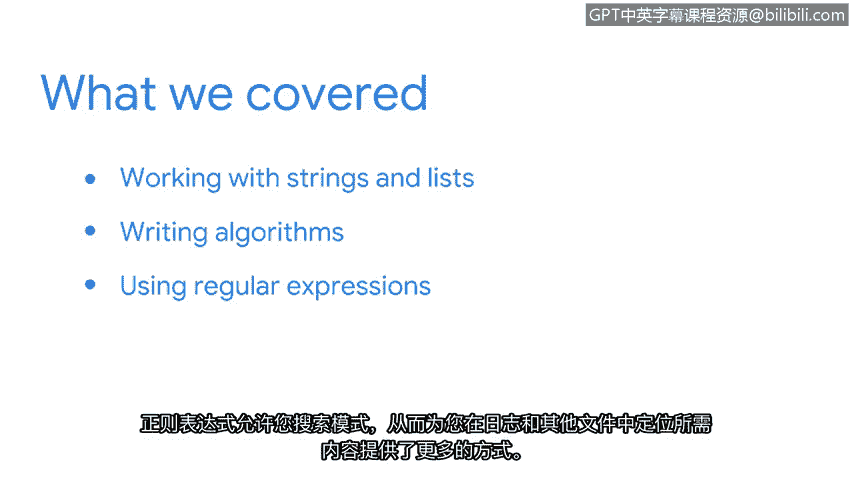

# 谷歌网络安全专业证书第七课：《用Python自动化网络安全任务》（中英字幕，前面分p中字，后面分p英字） - P29：28_总结.zh - GPT中英字幕课程资源 - BV1Dp4y1G759

Congratulations， we accomplish a lot together。Let's take time to quickly go through all the new concepts we covered。

We started this course by focusing on working with strengths and lists。

We learn methods that work specifically with these data types。

We also learned to work with indices and extract the information we need。Next。

 we focused on writing algorithms。 we wrote a simple algorithm that is sliced the network ID from a list of IP addresses。

Finally， we covered using regular expressions。 Reg expressions allow you to search for patterns。

 and this provides expanded ways to locate what you need in logs and other files。

 These are complex concepts。 and you are always welcome to visit the videos again， whenever you like。

😊。

With these concepts， you took a big step towards being able to work with data and write the algorithms that security professionals need。

Throughout the rest of this course， you're going to get more practice with Python and what it can offer to security analysts。

