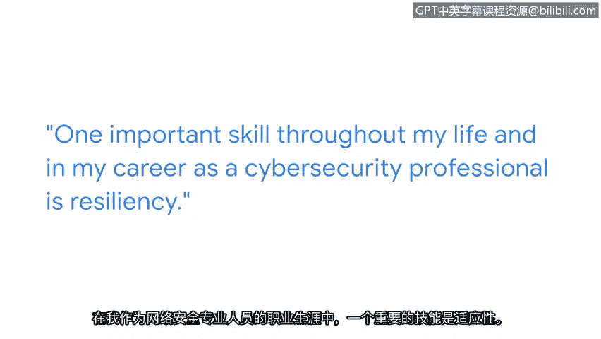

# 谷歌网络安全专业证书第七课：《用Python自动化网络安全任务》（中英字幕，前面分p中字，后面分p英字） - P2：1_安吉尔：我的个人职业之旅.zh - GPT中英字幕课程资源 - BV1Dp4y1G759

My name is Zanghi and I'm a security engineer at Google。

 There were a number of things in my life that led me to security。

 One of them was definitely curiosity when I was growing up。

 my parents are accountants and so they had pocket calculators and mechanical pencils and pens。

 and I was always breaking them up and taking pieces apart and trying to figure out how they work。

 This led me to technology in general。 and the same concept applied again。

 just trying to figure out how things work and breaking them。

 That's basically what security is trying to do breaking things to figure out whether or not somebody else could break them before you do I started as a network engineer。

 This was setting up firewalls setting up switches and routers for different companies。

 I wanted to join cybersecurity， mostly because I felt very motivated about the things that were going on in the industry and project aora was Google getting hacked by a foreign actor。

 I was reading。And I was thinking I wish I could work with the people that are working on these on the front lines when I was starting to get into cybersecur and I wanted to make a jump in my career what I wanted to learn where I needed to be One example is learning automation through Python I took online classes。

 I completed certifications， security certifications。

 very popular ones and then I just started to incorporate some of these aspects into my current job。

When I was moving from Mexico to the US to work here， I had to learn how to be flexible。

You have to learn new things in order to advance your career。

 Sometimes even you have to learn new things just to stay at the same spot you are And in security。

 I think in all of technology， but especially in securitycur。

 you constantly have to reinvent yourself， keep learning how things work and keep learning how you can help the industry。

 One important skill throughout my life and in my career as a cybersecurity professional。

 is resiliency。 I learn a lot about resiliency when I first moved here in the US and。

Things didn't go the way I expected them to。 And I have to keep trying new things。

And hope for the best。And that is really no different from what we do as a security professionals。

 We do this on a day to day basis。 We have to either figure out ways to make things work。

We have to figure out ways to make projects function the way we need them to。

 or we have to figure out ways to get past a problem。

 We need more professionals in cybersecurity with different backgrounds。

 and that means different experiences， different ways of seeing things。

 different ways of approaching and solving problems。 we need more people like you in this industry。

