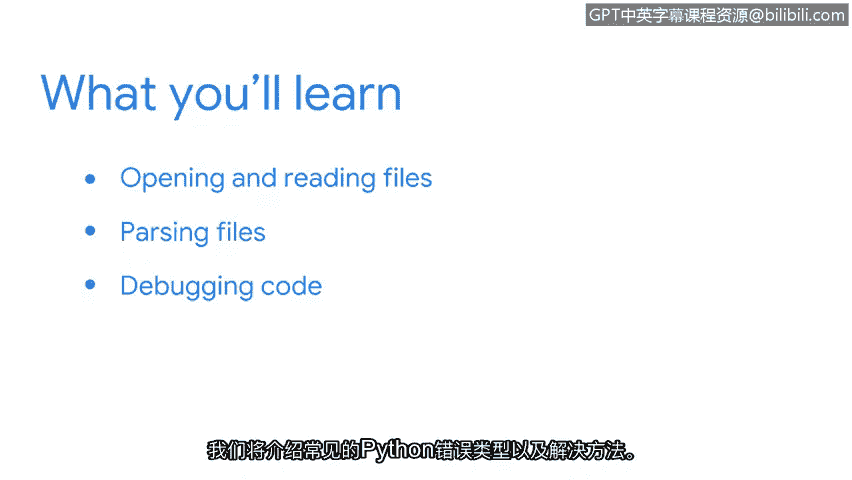

# 谷歌网络安全专业证书第七课：《用Python自动化网络安全任务》（中英字幕，前面分p中字，后面分p英字） - P30：29_欢迎来到第四周.zh - GPT中英字幕课程资源 - BV1Dp4y1G759

We've learned a lot about Python together already， and we still have more to cover。In this section。

 we're going to explore how a security analyst like yourself。Puts Python into practice。

 as a security analysts。You'll likely work with security logs that capture information on various system activities。

These logs are often very large and hard to quickly interpret。

 But Python can easily automate these tasks and make things much more efficient。 So first。

We'll focus on opening and reading files in Python。

This includes log files will then explore parsing files。

 This means you'll be able to work with files in ways that provide you with the security related information that you're targeting。

Finally。😊，Part of writing code is devogging code。 It's important to be able to interpret error messages to make your code work。

Willll cover common types of Python errors and ways to resolve them。Overall。

 after completing this section， you'll have a better understanding of Python and how as a security analyst。

 you can use it。 I can't wait to join you。😊。