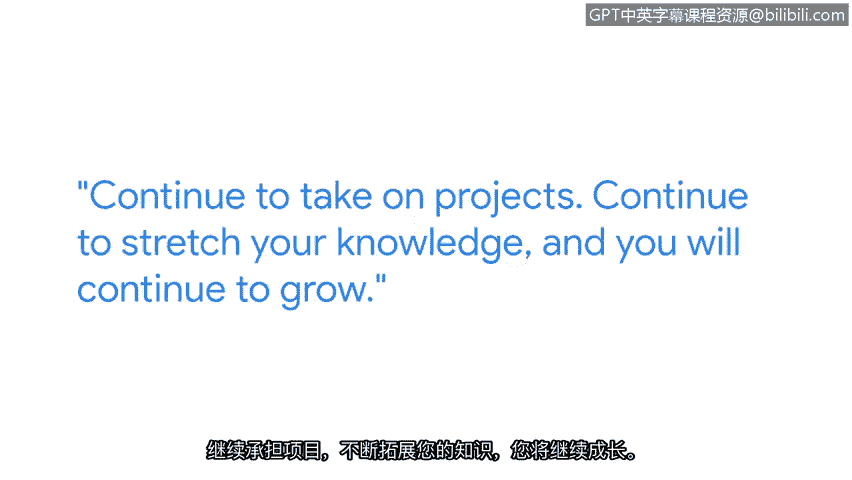

# 谷歌网络安全专业证书第七课：《用Python自动化网络安全任务》（中英字幕，前面分p中字，后面分p英字） - P32：31_克兰西：持续学习和Python.zh - GPT中英字幕课程资源 - BV1Dp4y1G759

My name is Clancy and I'm a senior security engineer。

 My team here at Google is part of an ongoing effort to protect Google's sensitive information。

 customer data PI every day is different at my job， It allows me to use different skills。

 knowledge sets and no day is a like by trade， I am not a engineer or software engineer at all I was actually an accounting being affected by any type of cybersecurity attack。

 definitely gives you perspective on the opposite side。

 you get to see how this affects users how this affects people that were attacked。

 had I known when I first started out how big of a field cybersecurity really was It would have allowed me to explore Python is a developmental language I use it very frequently at my role at Google one of my favorite things about Python is the power of the language you can use it to create very powerful scripts that you'll use in your day-to-day role When I first picked up Python。

 The trickiest part was learning how to say things the pythonic way。

Use various resources online as well as books as well as picking up side projects One of the best things about Python is a very widely used language and you can find many。

 many resources online depending on your skill set Python as well as any other developmental language is constantly evolving。

 continue to take on projects， continue to stretch your knowledge and you'll continue to grow The advice I can give for a person starting to learn Python is make it fun I think once you find learning a language to be fun it allows you to be more engaged develop a good baseline for what cybersecurity is。

 make yourself a little well rounded in the beginning and then from there you can branch out and deep dive into subjects that are interesting to you when starting out。

 it can be very tough and you feel as if you're climbing up a big hill。

 persevere continue to learn and then it will be a very rewarding experience。

