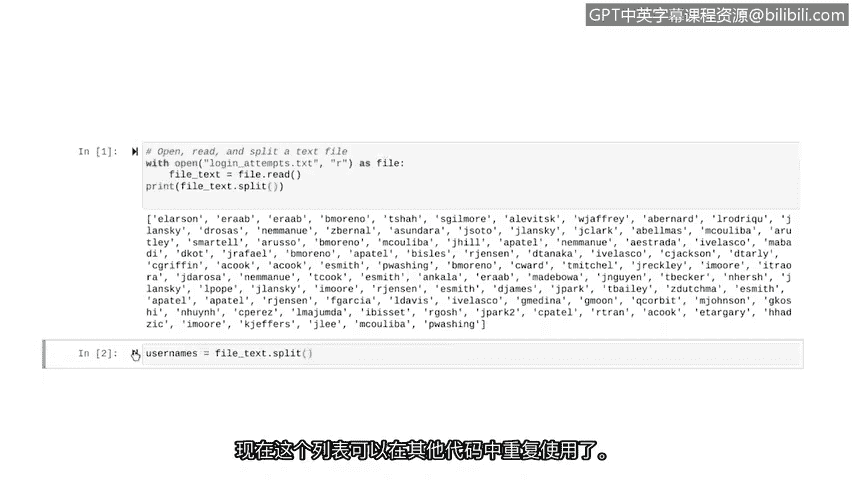
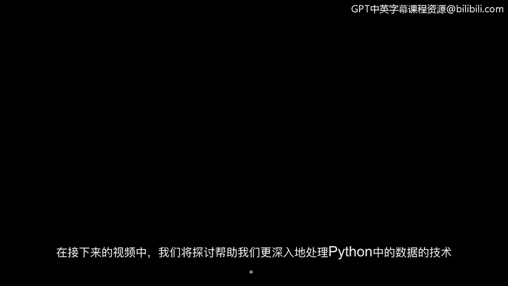

# 谷歌网络安全专业证书第七课：《用Python自动化网络安全任务》（中英字幕，前面分p中字，后面分p英字） - P34：33_用Python解析文本文件.zh - GPT中英字幕课程资源 - BV1Dp4y1G759

Now that you know how to import text files into Python。

 we're going to take this one step further and learn how to give them a structure。

This will allow us to analyze them more easily。This process is often referred to as parsing。

Parsing is the process of converting data into a more readable format。To do this。

 we're going to put together everything we learn about lists and strings and learn another method for working with the strings in Python。

The method we need is the split method。The split method converts the string into a list。

It does this by separating the string based on a specified character， or if no argument is passed。

Every time it encounters a white space， it separates the string。 So a split would convert the string。

 We are learning about parsing。Into this list。We are using the split method to separate the strings into smaller chunks that we can analyze more easily than one big block of text。

In this video， we'll work with an example of a security log where every line represents a new data point。

Store these points in a list。 We want to separate the text based on the new line。

Python considers a new line to be a type of white space。

 so we can use the split method without passing an argument。

We'll start with our code from the previous video。 Remember。

 we use this code to open a file and then grid it into a string。Now。

Let's split that string into our list using the split method and then print the output。

After we run it。Python outputs a list of usernames instead of one big string of them。

If we want to save this list。We would need to assign it to another variable。 For example。

 we can call the variable usernames， and then we run it again。

And now this list can be reused in other code。

Congratulations， you just learned the basics of parsing a text file in Python。😊，In the next videos。

 we're going to be exploring techniques that help us work more in depth with data in Python。😊。

