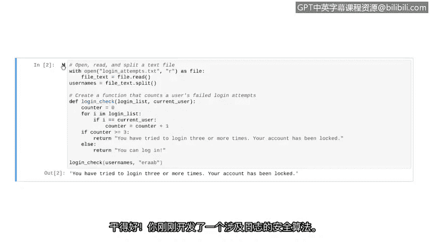

# 谷歌网络安全专业证书第七课：《用Python自动化网络安全任务》（中英字幕，前面分p中字，后面分p英字） - P35：34_用Python开发解析算法.zh - GPT中英字幕课程资源 - BV1Dp4y1G759

We're now going to bring all of the pieces together to import a file， parse it。

 and implement a simple algorithm to help us detect suspicious login attempts。In this video。

 we want to create a program that runs every time a new user logs in and checks if that user has had three or more failed login attempts。

First。Let's discuss the structure of our inputs to build a strategy to develop our program。

We have a log file stored in a TXD format that contains one username per line。

Each username represents a failed login attempt。So when I use to logs in。

We want our program to check for their username and count how many times that username is in our log file。

If that username is repeated three or more times， the program returns an alert。

We'll start with code that imports the file of logging attempts。 It splits it。

 and it stores it into a variable named usernames。Let's try printing the variable username to check for its contents。

We'll run this。Perfect， this is exactly what we expected。

The variable usernames is ready to be used in our algorithm。Now。

 let's develop a strategy for counting username occurrences in a list。

We'll start with the first eight elements of the username list。

We notice that there are two occurrences of the username E R A A B， in the list。

But how would we tell Python to count this。We'll implement a for loop that iterates through every element。

Let's represent a loop variable with an arrow。We also define a counter variable that stars at 0。

So our for loop starts at the username E， L， A， R， S， O， N at every element Python asks。

Is this element equal to the string E R A A B。If the answer is， yes。The counter goes up by one。

If it isn't。Then the counter stays the same。Since E， L A R S O N is not the same as E， R A A B。

 the counter remains 0。Then we move on to the next element。We encounter our first occurrence of E， R。

 A A B。At this point， the counter increases by one。As we move to the next element。

 we find another occurrence of E R A A B。So we increase our counter by one again。

That means that our counter is now at2。We would continue this process for the rest of the list。

Now that we know the solution， let's talk about how to implement it in Python。

 solvinglving the problem in Python will involve a for loop， a counter variable and an Efa statement。

Let's get back into our code。Will create a function that counts a users's fail logging attempt。First。

Let's define our function。We'll call it login check。It takes two parameters。

The first is called login list。These will be used for the list of failed logging attempts。

The second is called current user。These will be used for the user， who logs in。

Inside of this function， we start by defining the counter variable and set its value to 0。

Now we start a for loop。We'll use I as our loop variable and iterate through the login list。

In other words， as the loop iterates， it would run through all the failed login attempts in the list directly inside of the for loop。

 We start the EA statement。The EA statement checks if our loop variable is equal to the current user we are searching for。

If this condition is true。We want to add one to the counter。We're almost done with our algorithm。Now。

 we just need the final if else statement to print the alert。If the counter adds up to three or more。

 we need to tell the user that their account is locked so they can't log in。

We'll also type an El statement for users who can log in。Our algorithm is complete。

 Let's try out our new function on an example， username。😊。

We can pull out a few of the username in the list and try our function on them。

Let's use the first name in the list。Let's run the code。According to our code。This user can log in。

They have fewer than three failed logging attempts。Now， let's go back to our user， ER AAB。Remember。

 they had two entries in the list of the first eight names in our failed login attempts。

Do you think they'll be able to log in。When we run。We get an account locked message。 This means。

They had three or more failed login attempts。Excellent work。

To just develop your first security algorithm involving a log。As you grow in your skills。

 you learn how to make this algorithm more efficient。 But this solution works well for now。

In this video， we reed everything we learned so far。

 from list operations to algorithm development all the way to file parsing。😊。

We did this while building an algorithm we can apply in a security context。

