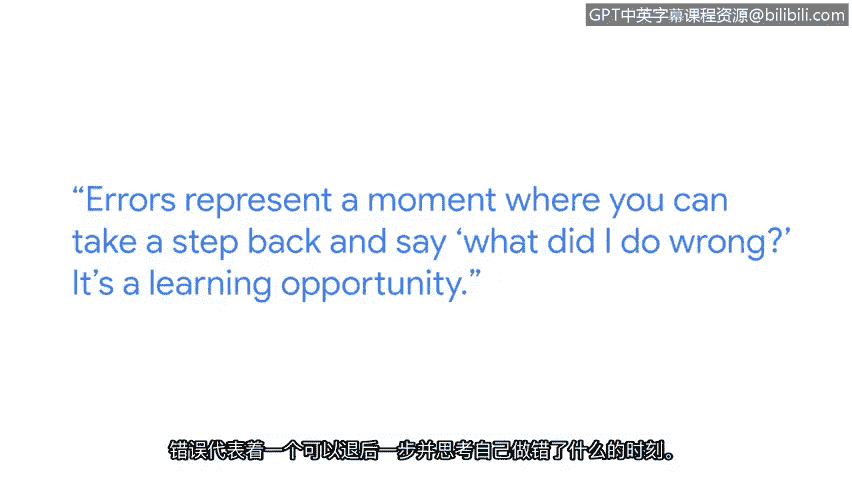

# 谷歌网络安全专业证书第七课：《用Python自动化网络安全任务》（中英字幕，前面分p中字，后面分p英字） - P37：36_马特：从错误中学习.zh - GPT中英字幕课程资源 - BV1Dp4y1G759

My name is Matt， I am a software engineer working in cybersecurity when I was in high school。

 what I really want to do was music， I was a musician。

 so I went to music school for jazz trombone partway through that process I realized no like band leader in the right mind looks at a group and thinks we need a trombone play like this is what makes this better I grew up watching。

Movies like the matrix。 and， you know， it's not very realistic to what cybersecurity work actually is but it is kind of inspiring。

 Like， you know， if you kind of like dig through the work specifics of what you do and take the broad step back。

 Like you are that you know， Google I was sunglasses Like you're a hacker。

 When I first started writing code。 I would look at coding errors as like a sign that I have done bad。

 But as I grew older， a little bit more mature， realize， you know， everyone has coding errors。

 literally the very best software engineer， I know writes code and it has errors。

 errors represent a moment where you can take a step back and say， what did I do wrong。

 It's a learning opportunity Now I see these as you know。

 like moments where I can look at some problem that I don't understand and be like。😊。

Why and dive into it and like expand my knowledge of computer science， which is like my whole job。

 So I see this as kind of a learning process， and it's a little bit fun。😊，So， one of the like。

Really messy coding errors that I've run into in my time here at Google involved fingerprinting when we find a vulnerability。

 if we find the same vulnerability later， we don't want to have two vulnerababilityities。 You know。

 like we don't want to poke someone twice and be like， hey， fix this thing。

 if it's the exact same thing。 So we do this thing called fingerprinting where we say this vulnerability has a specific fingerprint。

 And if we find another vulnerability that has the same fingerprint。

 we're not gonna store them separately or treat them separately。 They're effectively the same。

 I was running into these errors where things would not fingerprint in the way that I expected them too。

 I was literally like grinding my gears for weeks， trying to figure out like what is going on at this thing。

 But when I found it was very， very satisfying。 like， oh， like that's it。😊。

When you're in the middle of this mess， all of that self-doubt creeps into your brain。

 you're like I like maybe I'm not as good at this thing as I thought I was what I would go back and tell my like self A。

 it's not endless， it gets better。 once you figure it out that feeling a reward is incredible。 but B。

 also it's okay to rope people in right if you are struggling with something。

 I always advocate for like asking for help。 Most people are really excited to go help you out with this thing。

 especially when it's like a convoluted problem。😊，I am so thrilled。 I ended up in cybersecurity。

 Cybersecurity is having its moment。 People are realizing waking up to the amount of data that they're putting out into the world and they're starting to care about it。

 So every day there's something new。 every day， there's something kind of like exciting for me to do。

 And yeah， get into it。 Cysecurity is the way。😊。