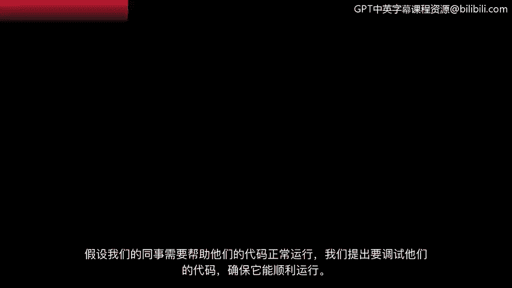
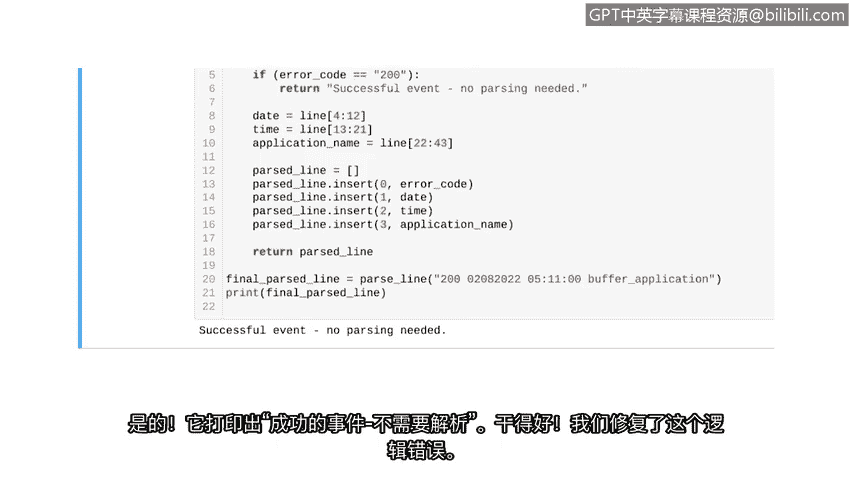

# 谷歌网络安全专业证书第七课：《用Python自动化网络安全任务》（中英字幕，前面分p中字，后面分p英字） - P38：37_应用调试策略.zh - GPT中英字幕课程资源 - BV1Dp4y1G759

Let's say our coworkers need some help getting their code to work。

And we offered to devo their code to make sure it runs smoothly。 First。

 we need to know about the purpose of the code。 In this case。

 the purpose of the code is to parse a single line from a log file and return it。The log file。

 we're using tracks potential issues with software applications。

Each line in the log contains the HTTP responses status codes， the date。

 the time and the application name when writing this code。

 our coworkers consider whether all the status codes needed to be passed since 200 signals are successful event。

They concluded that lines with this status code shouldn't be parsed。Instead。

 Python should return a message indicating that parsing wasn't needed。To start the debugging process。

 let's first run the code to identify what errors appear。Our first error is a syntax error。

The error message also tells us the syntax error occurs in a line that defines a function。

So let's scroll to that part of the code。As you might recall。

 these function headers should end with a column。Let's go ahead and add that to the code。Now。

 the syntax error should go away。 So let's run the code again。So now our syntax error is gone。

 which is good news。 but we have another error。😊，A name error。

Name error is actually a type of exception， meaning we've written valid syntax。

 but Python can't process the statement。According to the error。

 the interpreter doesn't understand the variable application name at the point where it's being added to the parse line list。

Let's examine that section of code。This error means we haven't assigned the variable name properly。

So now let's go back to where it was first assigned and determine what happened。

We find that this variable is misspelled。There should be two pieces in application name， not one。

Let's correct the spell。Now that we fix it， it should work。So， let's run the code。Great。

 we fixed an error and an exception。And we no longer have any error messages。

 But this doesn't mean our divvogging work is done。

 Let's make sure the logic of the program work as intended by examining the output。

Our output is a parse line。 In most cases， this would be what we wanted。 But as you might recall。

 if the status code is 200。Our code shouldn't parsel line。 Instead。

 it should print a message that no parsing is needed。And when we call it with a status code of 200。

There was a logic error because this message wasn't displayed。

So let's go back to the conditional we used to handle a status quo of 200 and investigate。

To find a source of the issue， let's add printed the statements。In our printed statements。

 we include the line number and a description of the location。

We'll add one printed statement before the line of code containing return pass list。

Will add another above the EA statement that checks for the 200 status code to determine if it reaches the EA statement。

And we'll add one more printed statement inside the EA statement to determine whether the program even enters it。

Now， let's run the code and review what gets printed。

Only the first printed statement printed something。The other two printed statements after this。

 didn't print。This means the program didn't even enter the EA statement。

The problem occurred somewhere before the line that returns the parseel line variable。

Let's investigate。When Python encounters the first return statement， which sends back the parse list。

It exits the function。 In other words， it returns the least before it even checks for a status code value of 200。

To fix this， we must move the EA statement， checking for the status code somewhere before returns parse line。

Let's first delete our printed statements。This makes the program more efficient because it doesn't run any un needed lines of code。

Now， let's move the EA statement。We'll place it right after the line of code that involves parsing the status code from the line。

Let's run our code and confirm that these fix our issue。Yes， it printed successful event。

 No parking needed。

Great work。 Will fix this logic error。I enjoy devogging this code with you。

 I hope this video has strengthen your understanding of some helpful debugging strategies。😊。

And gave you an idea of some errors you might encounter。

