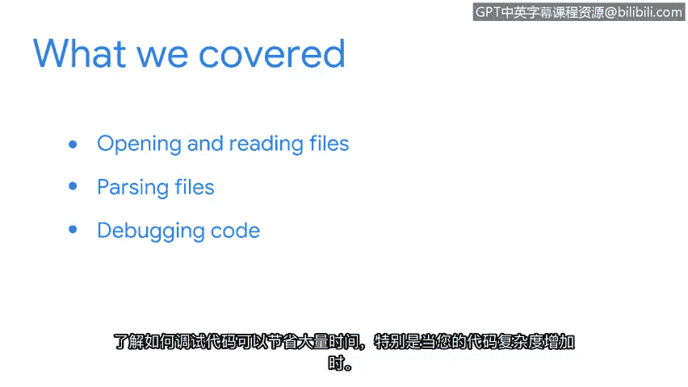

# 谷歌网络安全专业证书第七课：《用Python自动化网络安全任务》（中英字幕，前面分p中字，后面分p英字） - P39：38_总结.zh - GPT中英字幕课程资源 - BV1Dp4y1G759

Great work in this section。 We focus on a few new topics that will help you put Python into practice in the security profession。

😊，First， we explored opening and reading files in Python。

 Security analysts worked with a lot of log files。 So the ability to do this is essential。Next。

 we covered parsing files。Lo files can be very long。 For this reason。

 struct in these files to make them more readable helps you automate your tasks and get the information you need。

 And last， we focus on debugging code。Knowing how to debuok your code can save you a lot of time。

 especially as your code increases in complexity。

Overall， I hope you feel proud of what you've accomplished in this section。

Addressing security issues through Python is exciting。

 and the information we covered will allow you to do that。

