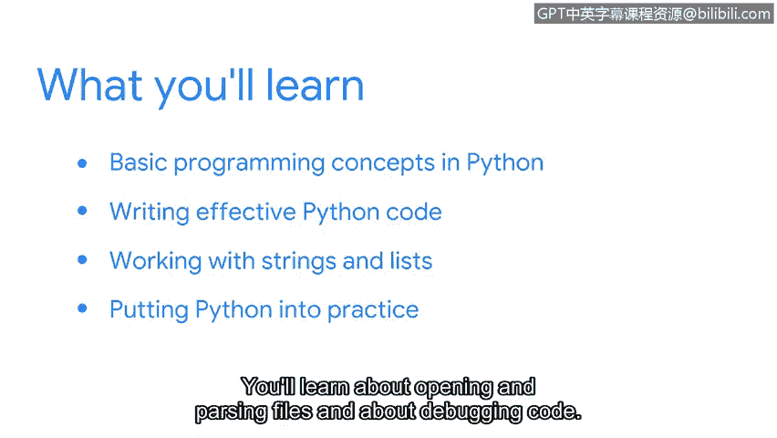

# 谷歌网络安全专业证书第七课：《用Python自动化网络安全任务》（中英字幕，前面分p中字，后面分p英字） - P41：0_01_introduction-to-course-7.en_subtitled - GPT中英字幕课程资源 - BV1Dp4y1G759

The demand for security professionals has never been higher。

Organizations across the world require professionals with your knowledge and skills to protect their systems from attackers。

And with the number of threats on the rise， security professionals often perform a diverse set of tasks。

 It's for this reason that will incorporate another tool as part of our security toolbox。

A tool that can simplify many common security tasks。

A tool that's used not only by security professionals， but also by engineers and data scientists。

That will is Python。Hi there。 Congratulations on getting to the next step in your security journey。

 My name is Anhill， and I am a security engineer at Google。

 I'm excited to be joining you in this course。😊，If you've been following along sequentially。

 you've already applied a specific tools that security professionals use during the detection。

 analysis and response processes。And you also learn how to communicate with your computer through Linux and SQL。

 Now we'll focus on how programming in Python can be used for some common security tasks。

 As you consider your next career step， you might find that Python skills will help you in your everyday work。

This course is designed for learning Python， starting with the basics。

 Then you'll gradually build on those basics and apply what you learn to gain hands on practice with security related examples。

 fortunately。Python is known for its readability， and just like all languages。

It will get easier with practice。Pretty soon， you might be using Python in your security career。

Python can automate the manual effort of important tasks like file parsing。

Byon has helped me a lot in my career here at Google。

I am part of a team responsible for protecting Google's infrastructure。

 which includes everything that employees use from laptops and desktops to the network and cloud resources。

We do this by engineering security solutions and automating the repeatable parts of our work。

What I like about Python is that it has cross platform support。

 and a lot of tools have already been developed by members of the security community that use Python。

This makes it easy for me to find the tools I need and get support with blockers so I can complete both my professional and personal projects。

My hope is that this course will be helpful to you。Let's explore what we'll cover。 First。

 you'll be introduced to basic programming concepts in Python。

 You'll learn why Python has been adopted by security professionals around the world。

 You will also develop and run your first program。After this。

 we'll focus on writing effective Python code。 We'll discuss concepts that help make our work more efficient。

 Our next main topic is on working with strings and lists。

 These will be relevant to a lot of the data that you will encounter in a security context。

 And finally， you'll wrap up the course with an exploration of putting Python into practice。😊。

You learn about opening and parsing files， and about debugging code。

Pthon is certainly a useful skill for security analysts。Let's get started。

