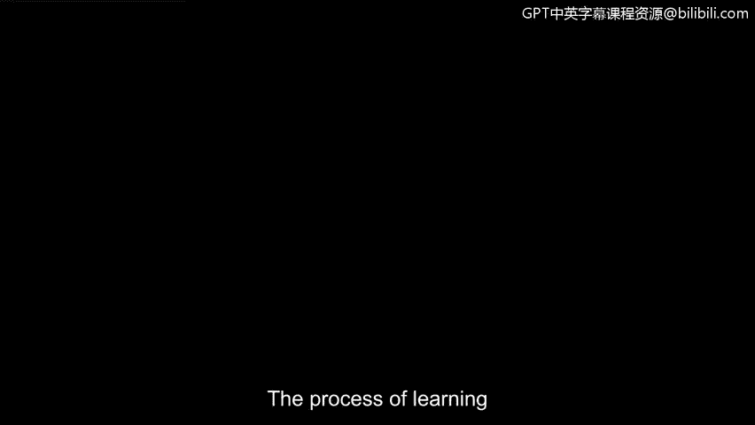
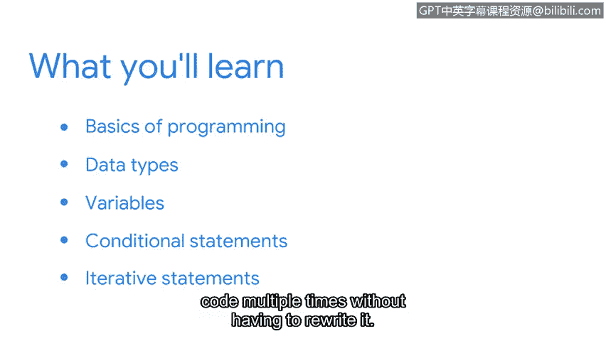

# 谷歌网络安全专业证书第七课：《用Python自动化网络安全任务》（中英字幕，前面分p中字，后面分p英字） - P43：2_01_welcome-to-week-1.en_subtitled - GPT中英字幕课程资源 - BV1Dp4y1G759

The process of learning a new programming language is similar to learning a new language。

 For instance， like any human language， programming consists of words。

Organized together to form lines of code。Lines of code are used to communicate with a computer。

 similar to a sentence。Telling it how to perform a task in this section。

 we're going to start learning the language needed to communicate with a computer as we explore some key components of Python。

We'll start by introducing the basics of programming， starting with why securityana is used byython。

Next， we'll start building the foundations for Python。We'll discuss data types。

 Then we'll cover variables。 Lastly， we're going to learn about specific statements we can make in Python。

 like conditional statements。Conditional statements help us incorporate logic into our programs。

The second type of a statement we'll learn about is the iterative statement。

Itterative statements allow us to repeat a line of code multiple times without having to rewrite it。

Learning Python helped me succeed in my career because using Python allows me to free up time from repetitive tasks and instead focus on more challenging tasks and problems。

Successfully applying automation reduces my overall workload， increases productivity。

 and reduces the risk of human error。The use of automation also allows me to focus on my engineering tasks。

 which require more creativity， collaboration， and problem solving。

Are you ready to start programming in Python？ Let's begin。

