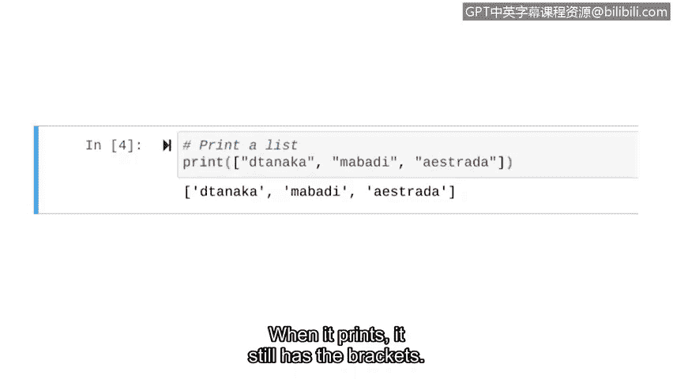

# 谷歌网络安全专业证书第七课：《用Python自动化网络安全任务》（中英字幕，前面分p中字，后面分p英字） - P47：6_01_data-types-in-python.en_subtitled - GPT中英字幕课程资源 - BV1Dp4y1G759

Our next topic relates to categorizing data in Python。First。

Let's take a moment to consider another environment where we apply categories。

We think about working in a kitchen When cooking， we can categorize the ingredients we use。

 For example， carrots and peppers are vegetables， and chicken and beef are meat。

These categories are important because they affect how we handle these ingredients。

 When working in Python， data types achieve a similar purpose。

 A data type is a category for a particular type of data item。Python uses several data types。

 We'll focus on the string。Float， integer， Booleion and list data。When we printed the text， hello。

 Python in our previous video。This was an example of a string。

String data is data consisting of an order sequence of characters。These characters could be letters。

 symbols， spaces， and even numbers。Numbers in the string data type cannot be used for calculations。

All characters in a string must be placed inside quotation marks。Luckily。

 Python will tell you by giving you a error message if you forget a quotation mark。

Let's use our code from before and explore what happens when we leave off the quotation mark。

Notice how one of our quotation marks is missing at the end of the stream。And when we run this code。

 well receive an error message。Python also supports numeric data types as well。

 When working with numeric data， we don't put quotation marks around the data。

Nummeric data includes floats and integers。Float data is data consisting of a number with a decimal point。

This includes fractions like 2。1 or 10。5。It also includes whole numbers with a decimal point like 2。

0 or 10。0。Integer data is data consisting of a number that does not include a decimal point。

Numbers such as 0，-9 and 5000 are valid integers。So far。

 we've used the print function to output a string。But it can also be used with float and integer types for calculations。

Let's try out an example of this。First。Since it's good practice。

 let's add a comment to explain the purpose of our code。Then we'll tell Python what to calculate。

The output gives us the answer。 One plus one is 2。We can use print with float and integer data to perform all kinds of mathematical operations like addition。

 subtraction， multiplication。And division。The third data type in Python is called a boion。

Bullion data is data that can only be one of two values， either true or false。

Williams are useful for logic in our programs。For example。

 let's compare numbers and determine the Boolean values of these comparisons。First。

 we'll use the print function to evaluate if。10 is less than 5。Then。

Will also evaluate if 9 is less than 12。So what do you think？10 is not less than 5。

 but 9 is less than 12， right。Let's see how Python handles this when we run it。Bath on the Greece。

The first line of output tells us that it's false to say，10 is less than 5。

And the second tells us it's true to say9 is less than 12。

We'll use Booleions more when we start including conditions in our code。

And the last data type willll cover is lists。List data is a data structure that consists of a collection of data in sequential form。

We'll create and print a list that prints all the username of the three individuals that have access to a confidential file。

First。We'll add our comment about an intention to print this list。After the keyword print。

 we'll add our list。We need to place the list in brackets。After this。

We place the individual items in the list in quotation marks and separate them with commas。Okay。

 now let's run this。As expected， we get the list。When it prints， it still has the brackets。

This is just the beginning of what you can do with lists。As you grow with your Python skills。

 you'll learn about how you can access and edit individual items in the list。

So that was a brief summary of five major data types in Python。Stng。Integer， float， Booleion。

 and least。These data types are some of the more common ones you'll work with as we progress through our lessons。

