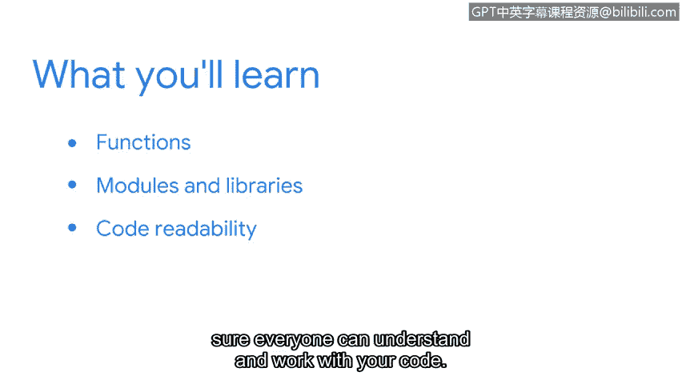

# 谷歌网络安全专业证书第七课：《用Python自动化网络安全任务》（中英字幕，前面分p中字，后面分p英字） - P53：12_01_welcome-to-week-2.en_subtitled - GPT中英字幕课程资源 - BV1Dp4y1G759

Welcome back to our Python journey In the previous videos， we learned all about the basics of Python。

 We started at the very beginning by understanding how security analysts use Python。

We learned several building blocks of Python。We went into detail learning about data types。

 variables and basic statements。Now we'll add to this and learn more about how to write effective Python scripts。

We'll discover ways we can make our efforts more efficient。

The upcoming videos are going to start by introducing functions which are very important in Python functions allow us to put together a set of instructions that we can use again and again in our code。

Afterwards， we're going to learn about Python modules and libraries。

 which include collections of functions and data types that we can use with Python。

 They help us gain access to functions without having to create them ourselves。Lastly。

 we're going to talk about one of the most important rules of programming and that is code readability。

 We'll learn all about ways to make sure everyone can understand and work with your code。

I'm excited that you've decided to continue your Python journey with me。

 So let's start learning more。