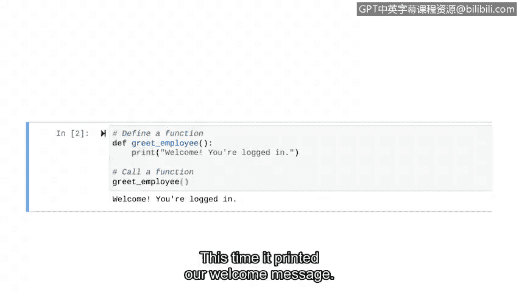
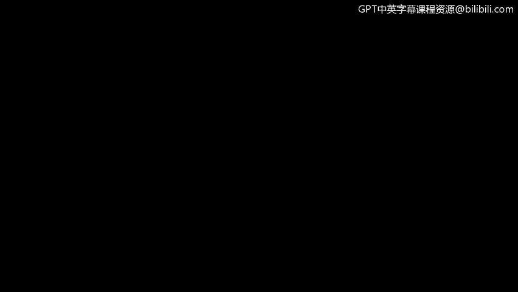

# 谷歌网络安全专业证书第七课：《用Python自动化网络安全任务》（中英字幕，前面分p中字，后面分p英字） - P55：14_03_create-a-basic-function.en_subtitled - GPT中英字幕课程资源 - BV1Dp4y1G759

Let's start our exploration of user defined functions by creating and then running a very simple function。

The first thing we need to do is define our function。When we define a function。

 we basically tell Python that E exists。The deaf keyword is needed for this。

Death is placed before a function name， to define a function。

Let's create a function that greets employees after they log in。First。

We'll comment on what we want to do with this code。We want to define a function。Now。

 we'll go to a new line and use the keyword de to name our function。We'll call it great employee。

Let's look at these syntax a little more closely。After our keyword depth and the function name。

 we place parenthesis。Later， we'll explore adding information inside the parentheses。

 But for this simple function， we don't need to add anything。Also。

 just like we did with conditional and iterative statements。

 we add a column at the end of this headter。After the colon will indicate what the function will do。

In our case， we want the function to output a message once the employee logs in。

So let's continue creating our function and tell Python to print this string。

This line is indented because it's part of this function。So what happens if we run this code？

Does it print our message。Let's try this。It doesn't。

That's because you also have to call your function。You may not realize it。

 but you already have experienced calling functions。

 Print is a built in function that we've called many times。

So to call great employee will do something similar。Let's go with a new line。

We'll add another comment because now our purpose is to call our function。And then。

Well call the great employee function。We run it again。This time， it printed our welcome message。

Great work。 We've now defined， and called a function。This was a simple function。

We're going to learn something next that will add to the complexity of the functions you write。

