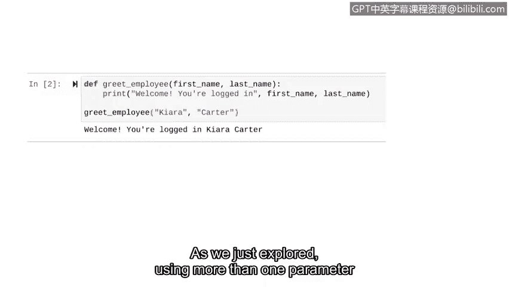

# 谷歌网络安全专业证书第七课：《用Python自动化网络安全任务》（中英字幕，前面分p中字，后面分p英字） - P56：15_01_use-parameters-in-functions.en_subtitled - GPT中英字幕课程资源 - BV1Dp4y1G759

Previously， we defined and called our first function。

It didn't require any information from outside the function。But other functions might。

 This means we need to talk about using parameters in functions。In Python。

 a parameter is an object that is included in a function definition for use in that function。

Parameters are accepted into a function through the parentheses， after a functioning。

The function that we created in the last video isn't taking in any parameters。

Now let's revisit another function called range that does use parameters。If you recall。

 the range function generates a sequence of numbers from a start point to the value before the stop point。

Therefore， range those include parameters for the start and stop indices that each accept an integer value。

For instance， it could accept integers 3 and 7。This means the sequence it generates will run from 3 to 6。

In our previous example， we wrote a function that displayed a welcome message when someone logged in。

It would be even more welcoming if we included the employee's name with the message。

Let's define a function with a parameter so we can greet employees by name。

When we define our function， well include the name of the parameter that our function depends on。

We place this parameter， the name variable inside the parenthsesis。

The rest of the syntax stays the same。Now， let's go to the next line and indent so that we can tell Python what we want this function to do。

We wanted to print a message that welcomes the employee using the name that's passed into the function。

Bringing this variable into our printer statement requires a few considerations。Like before。

 we start with the welcome message we want to print。In this case， though。

 we're not stopping our message after we tell them they are logged in。

We want to continue and add the employee's name to the message。

That's why we're placing a comma after you logged in。And then。Adding the name viable。

Since this is a variable and not a specific string。We don't place it in quotation marks。

Now that our function is set up， we're ready to call it with a specific argument that we want to pass in。

In Python， an argument is the data brought into a function when it is called。 for example。

 earlier when we passed3 and 7 into the range function。These were arguments。In our case。

Let's imagine we want to greet an employee named Charlie Patel。

We'll call our grid employee function with this argument。And when we run this。

 Charlie Patel gets a personalized welcome message。In this example。

 we only have one parameter in our function。But we can have more。Let's explore an example of this。

Maybe instead of a single name parameter， we have a parameter for first name and second parameter for last name。

If so， we would need to adjust the code like this。First， when we define the function。

 we include both parameters and separate them with a comma。Then， when we call it。

We also include two arguments。This time， we're greeting someone with the first name of Kiara and with the last name of Karu。

These are also separated by a coma。Let's run these and welcome Kra Carterter。As we just explored。

 using more than one parameter just requires a few adjustments。

Great work in this video。 We learn a lot about working with parameters， in a function。😊。

This understanding is something you'll need as you continue to write Pythonist scripts。

