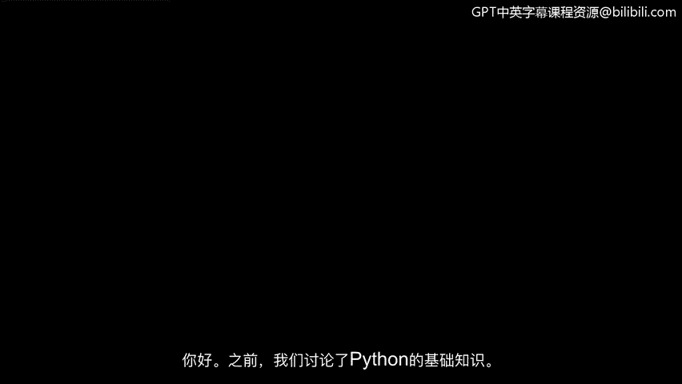
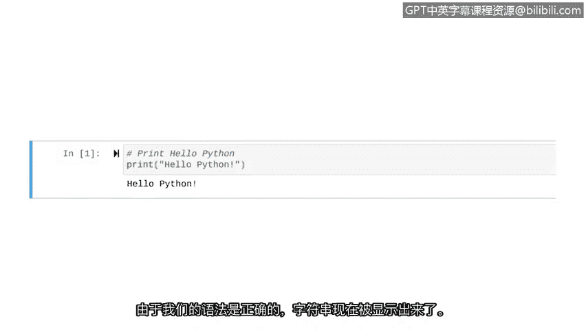
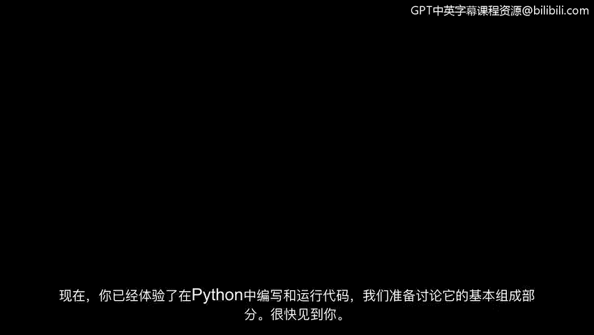

# 谷歌网络安全专业证书第七课：《用Python自动化网络安全任务》（中英字幕，前面分p中字，后面分p英字） - P5：4_创建一个基本的Python脚本.zh - GPT中英字幕课程资源 - BV1Dp4y1G759

Hi there。Previously， we discussed the basics of Python。Now we'll practice writing and running code。

When we work in Python， we refer to what we write as a script or a program。

There are subtle differences between the two。Let's compare a computer program to a theater performance。

Almost every theatre performance includes a written script。

 Actctors study and memorize a script to say it out loud to an audience。 However。

 that's not the only component。 There' is also the whole performance。

 Directors make decisions on what kind of lighting to use or costumes or what the stage looks like。

 The performance as a whole involves a lot of design choices like set design lighting and costumes。

The process of creating this production is similar to the process of programming in Python。

Programming involves a lot of the design decisions。

But the process of e scripting in Python is more like writing the specific words that the actors will say。

In Python， it's good practice to start with a comment。

A comment is a note programmers make about the intention behind their code。Let's add one， now。

We start with the hash symbol to indicate that this is a comment。

 and then we'll add details about our intention。Here。

 we're going to print hello Python to the screen。Okay， now let's write our first line of Python code。

This code uses print。Print outputs a specified object to the screen。After print。

 we put what we want to output in parenthsesis。In this case， we want to output the string hello。

 Python。We must place string data in quotation marks。

These quotation marks are just one example of syntax that youll encounter in Python。

Syntax refers to the rules that determine what is correctly structured in a computing language。

And now we'll run this code so the computer can output this string。

You just run your first line of code。Since our syntax is correct， the string is now displayed。

Now that you'd experience writing and running codingding Python。

 we are ready to discuss its basic components。Meade you soon。

