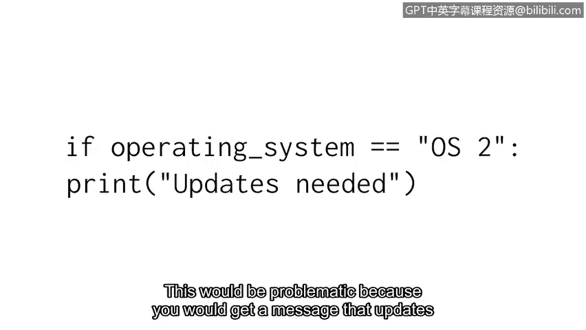

# 谷歌网络安全专业证书第七课：《用Python自动化网络安全任务》（中英字幕，前面分p中字，后面分p英字） - P60：19_03_code-readability.en_subtitled - GPT中英字幕课程资源 - BV1Dp4y1G759

Welcome back。 One of the advantages to programming in Python is that it's a very readable language。

 It also helps that the Python community shares a set of guidelines that promote clean and neat code。

😊，These are called style guides。 A style guide is a manual that informs the writing。

 formatting and the design of documents。As it relates to programming。

 the style guides are intended to help programmers follow similar conventions。

 The Pep 8 style guide is a resource that provides stylistic guidelines for programmers working in Python。

Pp is short for Python enhancement proposals。Pep 8 provides programmers with suggestions related to syntax。

They're not mandatory， but they help create consistency among programmers to make sure that others can easily understand our code。

It's essentially based on the principle that code is read much more often than it' written。

This is a great resource for anyone who wants to learn how to style and format their Python code in a manner consistent with other programmers。

For example， Pa8 discusses comments。 A comment is a note programmers make about the intentions behind their code。

 They are inserted in computer programs to indicate what the code is doing and why。

Pb 8 gives the specific recommendations like making your comments clear and keeping them up to date when the code changes。

 Here's an example of code， without a comment。The person who wrote it might know what's going on。

 But what about others who need to read it。They might not understand the context behind the failed attempts variable and why it prints a account locked if its greater than5。

 and the original writer might need to revisit this code in the future， for example。

 to devoke the larger program。Without the comment， they would also be less efficient。

 But in this example， we've added a comment。Other readers can quickly understand what our program and its variables are doing。

Comments should be short and right to the point。Next。

 let's talk about another important aspect of code readability， indentation。

Indentation is a space added at the beginning of a line of code。

This both improves readability and ensures that a code is executed properly。

There are instances when you must indent lines of code to establish connections with other lines of code。

These groups， they indented lines of code together and establishes a connection with a previous line of code that isn't indented。

The body of a conditional statement is one example of this。

We need to make sure this printed statement executes only when the condition is met。

Indenting here provides this instruction to Python。 If the printer statement were not indented。

 Python would execute this printed statement outside of the conditional。And it would always print。

This would be problematic because you would get a message that updates are needed。

Even if they're not。To indent， you must add at least one space before a line of code。Typically。

 programmers add two to four spaces for visual clarity。The Pep 8t guide recommends forest bases。

At my first engineering job， I wrote a script to help validate and launch firewall rules。Initially。

 Maya script worked well， but it became hard to read a year later when we trying to expand its functionality。

My programming， knowledge and coding style had evolved over that year。

 as had the coding practices of my teammates。Our organization did not use a coding style guide at that time。

 So our codes were very different， hard to read and did not scale well。

This caused a lot of challenges and required additional work to fix。

Ensuring that code is readable and can be modified over time。

It's why it's important for security professionals to adhere to coding style guides。

And why the style guides are so important for organizations to utilize。

The ability to write readable code is key when working in Python。

As we head into the next part of our course， we'll continue to develop effective code practices for better readability。

