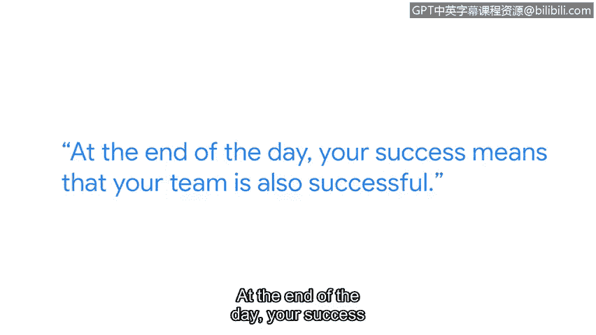

# 谷歌网络安全专业证书第七课：《用Python自动化网络安全任务》（中英字幕，前面分p中字，后面分p英字） - P61：20_05_dorsa-use-python-efficiently-on-a-cybersecurity-team.en_subtitled - GPT中英字幕课程资源 - BV1Dp4y1G759

Hi， my name is Dorsa and I'm a security engineer。 What I love the most about my job is that I get to look at different infrastructures and system designs on a daily basis。

 One piece of advice for individuals who are starting out in the cybersecurity profession。

 It's very important to work collaboratively in Python and one of the key aspects of that is to listen to the feedback that your team members provide。

 Python allows for many different ways of accessing different information when you share Python code snippets amongst your team members。

 it allows the code to be more uniform and the coding process to be more efficient。

 makes the codeb a lot more readable and it allows for other engineers to work on your code after you I've seen many examples of when collaboratively written Python code has been helpful in the industry。

 One of the examples is when at Google we wrote a collaboratively written codeb which allowed for an onboarding process to be reduced from6 or7 hours to a couple of minutes。

😊，Collaboration was a key part of this process because otherwise it would have taken many。

 many years for one single individual to write it， one individual is not able to understand every fine detail of each system and if you don't have multiple engineers working on it it would have made this process a lot more difficult communication is very important when you're working in a team and especially if you're developing code in Python you need to express whether you need help throughout the process because your team members are there to ensure that you are successful at the end of the day your success means that your team is also successful as you advance in your career as someone who writes code in Python。

 you'll realize that there are a lot of functions and methods that are just sticking around on the internet and you will be able to find them with a quick search and those methods will come in handy and you will be able to reuse them for your pieces of code。

😊。

A really good resource for you to learn new skills and expand your Python coding skills is to talk to your colleagues。

 attend meetups， talk to different security professionals who don't work at your company because everyone has an insight on how to make your coding skills especially in cybersecurity better。

