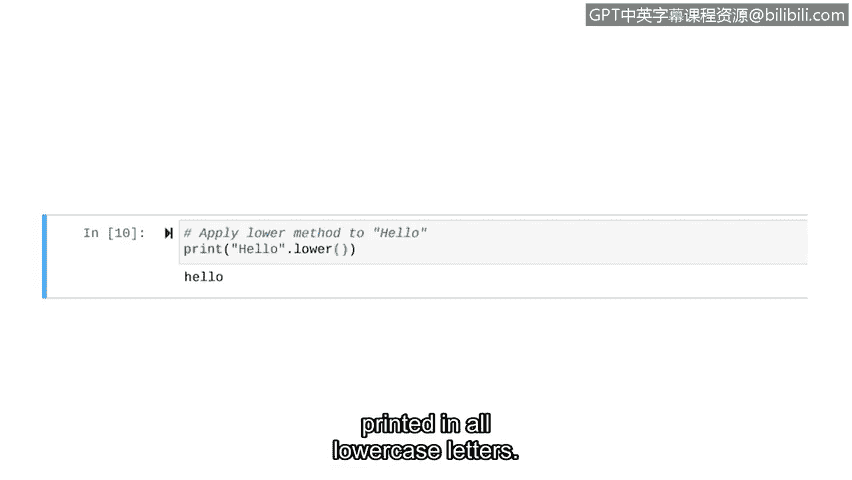

# 谷歌网络安全专业证书第七课：《用Python自动化网络安全任务》（中英字幕，前面分p中字，后面分p英字） - P64：23_02_string-operations.en_subtitled - GPT中英字幕课程资源 - BV1Dp4y1G759

Knowing how to work with string data in security is important。For example。

 you might find yourself working with usernames to find patterns in login information。

We're going to revisit the string data type and learn how to work with it in Python first。

Let's have a quick refresher on the strings。We defined the string data as data consisting of an order sequence of characters。

In Python， the strings are written in between quotation marks。

It's okay to use either double or single quotation marks。 But in this course。

 we've been using double quotation marks。As examples， we have the strings， hello。1，2，3。

 and number one。We also previously covered variables。Here。

 the variable my string is currently storing the string security。

You can also create a string from another data type， such as an integer or a float。To do that。

 we need to introduce a new built in function， the string function。

The string function is a function that converts the input object into a string。

Converting objects to strings allows us to perform tasks that are only possible for strings。

For example， we might convert an integer into a string to remove elements from it or to reorder it。

Both are difficult for an integer data type。Let's practice converting an integer to a string。

Will apply the string function to the integer 123。Now。

 the variable new string contains a string of three characters，1，2， and 3。

Let's print its type to check。We will run it。Perfect， it tells us that we now have a string。Awesome。

 so far， we know different ways to create and store a string。😊，Now。

 let's explore how to perform some basic string operations。Our first example is the length function。

The length function is a function that returns the number of elements in an object。

Using it on a string tells us how many characters the string has。Earlier in the program。

 we learned that IP P addresses have two versions， IPV 4 or IPV 6。

IPV4 addresses have a maximum of 15 characters。 so a security professional might use the linked function to check if an IPV4 address is valid。

If its length is greater than 15 characters， then we'd know that it's an invalid IP before address。

Let's use this function to bring the length of the string， hello。

Will nest the length function within the print function。

 because we want to first calculate the length of this string and then print it to the screen。Okay。

 let's run this and check out how many characters Python counts。The output is 5。

1 for each letter in the word， hello。We can also use the addition operator on the strings。

 This is called a string concatenation。 The string concatenation is the process of joining two strings together。

For example， we can add these strings hello and worth together。To concatenate strings。

 we can use the plus symbol。After we run it， we get hello word。

With no spaces in between the two strings。It's important to note that some operators don't work for strings。

For example， you cannot use a minus sign to subtract the two strings。Finally。

 we're going to talk about string methods。A method is a function that belongs to a specific data type。

So using a string methods on another data type like an integer would cause an error。

Unlike other functions。Methods appear after the string。

Two common string methods are the upper and the lower methods。

The upper method returns a copy of the string in all upper case letters。

Let's apply the upper method to the string， hello。We'll place this inside of a print function to output it to the screen。

Let's focus on the unique syntax of methods。After our string hello。We place a period or dot。

And then specify the method we want to use here。 that's upper。Okay， now we're ready to run this。

Hello is printed to the screen in all uppercase letters。Similarly。

 the lower method returns a copy of the string in all lower case letters。

Let's apply the lower method on the hell string。Remember that we need to put the string and the method inside of a print function to output the results。

And now we have the string printed in all lowercase letters。 Coming up。

 we're going to learn a lot more about strings， like indexing and splitting strings。😊。

I'm looking forward to meeting you there。