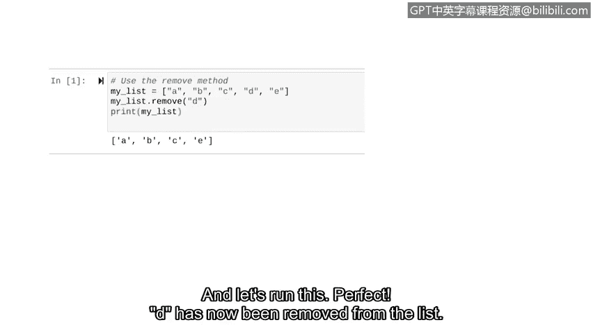

# 谷歌网络安全专业证书第七课：《用Python自动化网络安全任务》（中英字幕，前面分p中字，后面分p英字） - P66：25_01_list-operations-in-python.en_subtitled - GPT中英字幕课程资源 - BV1Dp4y1G759

Another data type we discussed previously is the list。

Listists are useful because they allow you to store multiple pieces of data in a single variable。

In the security profession， you will work with a variety of lists。For example。

 you may have a list of I P addresses that have access a network。

And another list might hold information on applications that are blocked from running on the system。

Let's re up how to create a list in Python。In this case。

 the items in our list are the letters A through E。We separate them by commerceas。

And surround them with squareir brackets。We can also assign our list to a variable to make it easier to use later。

Dear， we've named our variable My list。When we access specific elements from lists。

 we use syntax similar to when we access the specific elements from strings。

We place its index value in brackets after the variable that restore the list。

 So this would access the second item in the list。This is because in Python。

 we start counting the elements in at least at 0 and not at one。

So the index for the first element is 0， and the index for the second element is one。

Let's try extracting some elements from a list。We'll extract the second element by putting one in brackets after the variable。

We place this in a print function to output the results。And after we run it。

Python outputs the letter B。Similar to strings， we can also concatenate lists with the plus sign。

List concatenation is combining two lists into one by placing the elements of the second list directly after the elements of the first list。

Let's work with this in Python。Let's concatenate two lists。First。

 we define the same list as in the previous example and the stored in the variable， my list。Now。

 let's define an initial list with the numbers 1 through 4。Finally。

 let's concatenate the two lists with a plus sign and print out the result。And when we run it。

 we have a final concatenated list。Having discussed the similarities。

 let's now explore the differences between lists and strings。

We mentioned earlier that his strings are immutable。Meaning， after they are defined。

 they cannot be changed。 Ls， on the other hand， do not have this property。And we can freely change。

 add and remove list values。 So， for example， if we have a list of malicious I P addresses。

Then every time a new malicious I address is identified， we can easily add it to the list。

Let's first try changing a specific element in a listing Python。

We start with the least used in the previous example。To change an element in a list。

 we combined what we learned about bracket notation with what we learned about variable assignment。

Let's change the second element in my list， which is the string B to the number 7。

We place the object。 we want to change on the left hand side of the variable assignment。In this case。

 will change the second element in my list。Then we place an equal sign to indicate we are reassigning this element of the list。

Finally， we place the object to take its place on the right hand side。Here。

 we'll reassign the second list element to a value of 7。Now。

 let's print out the list and run the code to examine the change。Perfect。

The letter B is now changed to the number 7。Now， let's take a look at methods for inserting and removing elements in lists。

The first method we'll work with in this video is the insert method。

The insert method adds an element in a specific position inside a list。

The method takes two arguments。The first is the position we're adding the element to。

 and the second is the element we want to are。Let's use the insert method。

We'll start with the list we defined in our my list Bible。Then， we type。My list， dot insert。

And pass into arguments。The first argument is the position where we want to insert the new information。

In this case。We want to insert into index 1。The second argument is the information we want to add to the list。

In this case， the integer 7。Now。Let's print my list。Our list， it still begins with a。

The element with an index of 0。And now we have the integer 7 in the next position。

The position represented with an index of one。Notice that the letter B。

 which was originally at index 1， did not get replaced like when we use bracket notation。

With the insert method， every element beyond index 1 is simply shifted down by one position。

The index of B is now to。Sometimes we might want to remove an element that is no longer needed from a least。

To do this， we can use the remove method。The remove method removes the first occurrence of a specific element in a list。

Unlike insert。The argument of remove is not an index value。 Instead。

 you directly type the element you want to remove。The removed method removes the first instance of it in the list。

Let's use the remove method to delete the letter D from our list。

Willll type the name of our variable。 My least， then。Other removed methods。

We want to remove D from these lists。 So we will place it in quotation marks as our argument。Then。

Will print my list。And let's run thiss。Perfect， thee has now been removed from the least。

Just like with the strings， being able to search through lists is a necessary skill for security analysts。

I am looking forward to expanding our understanding as we move forward in this course。😊。

