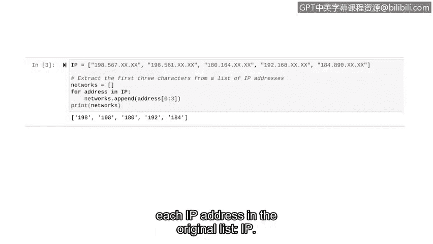

# 谷歌网络安全专业证书第七课：《用Python自动化网络安全任务》（中英字幕，前面分p中字，后面分p英字） - P67：26_02_write-a-simple-algorithm.en_subtitled - GPT中英字幕课程资源 - BV1Dp4y1G759

In our everyday lives， we frequently follow rules for solving problems。As a simple example。

 imagine you want a cup of coffee。If you've made coffee many times。

 then you likely follow a process to make it。First， you grab your favorite mug。

Then you pour water into the coffee maker and add your coffee grounds。

You press the start button and wait a few minutes。 Finally， you enjoy your fresh cup of coffee。😊。

Even if you have a different approach to making coffee or don't drink coffee at all。

 you likely follow a set of rules for completing similar everyday tasks。

 When you complete these routine tasks， you're following an algorithm。

An algorithm is a set of rules that solve a problem。In more detail。

 an algorithm is a set of steps that take an input from a problem。

 uses this input to perform tasks and returns a solution as an output。

Let's explore how algorithms can be used to solve problems in Python。Imagine that you。

 as a security analyst， have a list of IP addresses。

 You want to extract the first three digits of each I address。

 which will tell you information about the networks that these I addresses belong to。To do this。

 we're going to write an algorithm that involves multiple Python concepts that we've covered so far。

Loops， lists and strings。Here's a list with I P addresses that are stored as strings。

For privacy reasons， in our example， we are not showing the full IP addresses。

Our goal is to extract the first three numbers of each address。And them in a new list。

Before we write any Python code， let's break down an approach to solving this problem with an algorithm。

 What if you had one I P address instead of an entire list。Well。

 then the problem becomes much simpler。 The first step in solving the problem will be to use a string slicing to extract the first three digits from one I P address。

Now， let's consider how to apply this to an entire list。As the second step。

 we'll use a loop to apply that solution to every IP address on the list。😡，Previously。

 you learn about a string of slicing。 So let's write some Python code to solve the problem for one I address。

Here we are starting with one I P address that begins with 198 dot 5，6，7。

And we'll write a few lines of code to extract the first three characters。

We'll use the bracket notation to slice the string。Inside the printer statement。

We have the address variable， which contains the I P address we want to slice。

Remember that Python starts counting at  zero， so to get the first three characters。

 we start our slice at index 0。And then continue all the way until index 3。

Remember that Python excludes the final index。In other words。

 Python will return the characters at index 0，1 and 2。 Now， let's run this。

We get the first three digits of the address，198。Now that we're able to solve this problem for one IP address。

 we can put this code into a loop and apply it to all IP addresses in the original list。

Before we do this， let's introduce one more method that we'll be using in this code。

The append method。The append method adds input to the end of a list。 For example。

 let's say that my list contains one，2 and 3。 with this code。

 we can use the append method to add 4 to this list。First。We're given the I P list。

Now we're ready to extract the first three characters from each element in this list。

Let's create an empty list to store the first three characters of H from the list。

Now we can start the for loop。Let's break this down to word4。

Tells Python that we are about to start a for loop。

 We then choose address as the variable inside of the for loop。

And we specified the list called I P as the iterable。As the loop runs。

 each element from the IP list will be stored temporarily in the address variable。

Inside the for loop， we have a line of code to add the slice from address to the network list。

Breaking this down， we use the code we wrote earlier to get the first three characters of an IP address。

We'll use our append method to add an item to the end of a list。In this case。

 we're adding to the networks list。Finally， let's print the network's list。And run the code。

The variable networks now contains a list of the first three digits of each I P address in the original list。

 I P。

That was a lot of information。Designing algorithms can be challenging。

 So it's a good idea to break them down into smaller problems before jumping into writing your code。

We'll continue to practice this idea in the upcoming videos。Mit you there。

