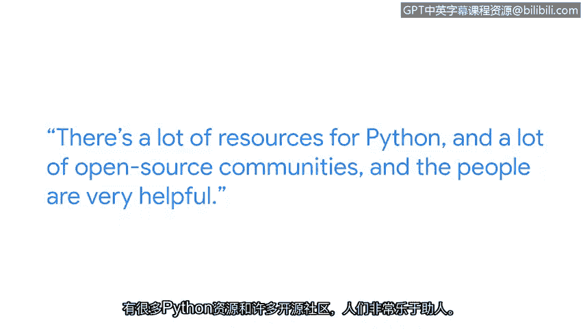

# 谷歌网络安全专业证书第七课：《用Python自动化网络安全任务》（中英字幕，前面分p中字，后面分p英字） - P6：5_阿卡什：Python和网络安全专业人员.zh - GPT中英字幕课程资源 - BV1Dp4y1G759

My name is Ahaash and I work as a security engineer at Google as a cybersecurity engineer you would end up using Python for most of your career It's very important that you learn Python when you are moving into cybersecurity you would be dealing with millions of data points and things like that which is gonna be very hard for you to go through manually so that's when Python comes in to automate and write scripts and small programs that will be able to do the same thing in a split second learning Python is super fun when you see like you know 10 lines of code doing things like you know passing through megabytes of data within second it can be very fulfilling theres a lot of resources for Python and a lot of open source communities and people very helpful stay curious and take up small problems and then get your hands dirty with doing it and don't be afraid of looking up syntax and you know learn online resources。

Job as a security engineer at Google Chrome is to protect our customers from foreign governments and very persistent threats across the world。

 The threats are unlimited， there is no limit to it and that's that's what makes cybersecurity very exciting。

 So stick with it its it's an essential skill that will take some time initially to develop but will serve you throughout the career。

