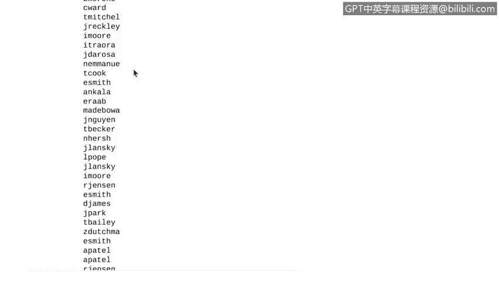

# 谷歌网络安全专业证书第七课：《用Python自动化网络安全任务》（中英字幕，前面分p中字，后面分p英字） - P73：32_01_access-a-text-file-in-python.en_subtitled - GPT中英字幕课程资源 - BV1Dp4y1G759

Security professionals are often tasked with reviewing log files。

These files may have thousands of entries， so it can be helpful to automate this process。

And that's where Python comes in。Let's start by importing a simple text file that just contains a few words and then rest storing it as a stringing python。

All we need is the text file， its location and the right Python keywords。

We're going to start by typing a with a statement。The keyword with。Handles errors。

 and manages external resources。When using width。Python knows to automatically release resources that would otherwise keep our system busy until the program finishes running。

It's often used in file handling to automatically close a file， after reading it。

To open files and then read them， we write a statement that begins with the keyword width。

Then we use the open function。Open is a function that opens a file in Python。

The first parameter is the name of the text file on your computer or a link to it on the Internet。

Depending on the Python environment， you might also need to include a path to this file。

Remember to include the dot T X， T extension in the file name。Now。

 let's discuss the second parameter。This parameter in the open function tells Python what we want to do with the file。

In our case， we want to read a file。 So we use the letter R between quotation marks。

If we wanted to write to a file， we would replace this R with a W。

 But here we're focusing on reading。Finally。File is a variable that contains the file information。

 as long as we're inside the width statement。Like with other types of statements。

 we and our with the statement with a column。The code that comes after the column will tell Python what to do with the content of the file。

Let's go into Python and use what we learned。We're ready to open a text filing python。

Now we'll type our width statement。😡，Next， we'll use Pythons built read method。

 The read method converts files into strings。Now， let's go back to our with statement。

Similar to a four loop with a statements is start an indent on the next line。

This tells Python that this code is happening inside the width statement。Inside of the statement。

 we're going to use the read function to turn our file into a string and store that inside a new variable。

This new variable can be used outside of the width statement。

So let's exit the width statement by removing the indentation and print the variable。Perfect。

 the string from the text prints out。

Coming up， we're going to discuss parsing files， so we are equipped to handle security logs in the future。

