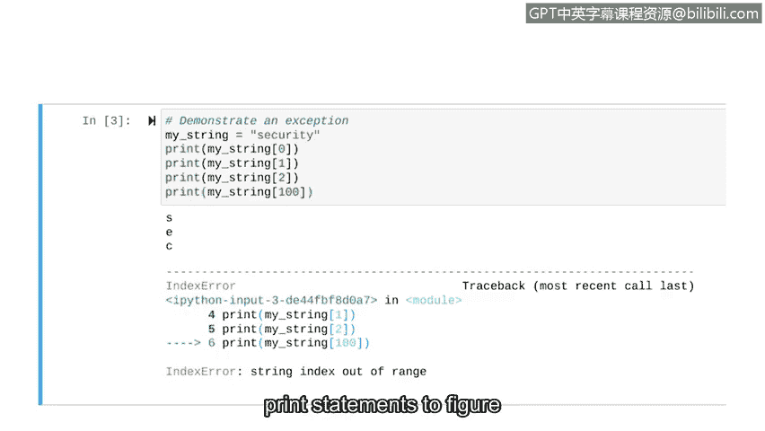

# 谷歌网络安全专业证书第七课：《用Python自动化网络安全任务》（中英字幕，前面分p中字，后面分p英字） - P76：35_01_debugging-strategies.en_subtitled - GPT中英字幕课程资源 - BV1Dp4y1G759

As a security analyst。You might be required to read or write code。

And one of the biggest challenges is getting it to run and function properly， in fact。

Fixing complex errors in code can sometimes take up just as much。

 if not more time than writing your code。This is why it's important to develop this skill。

Now that you learn the basics of coding in Python， it's important to learn how to deal with errors。

 For that reason， we'll focus on debug in your code。

Debugging is the practice of identifying and fixing errors code。 In this video。

 we'll explore some techniques for this。There are three types of errors， syntax errors。

Logic errors and exceptions。Syntax errors involve invalid usage of the Python language。

Such as forgetting to add a column after a function header。Let's explore this type of error。

When we run this code， we get a message that indicates there's a syntax error。

Depending on the Python environment， it might also display additional details。

Well typically get information about the error， like its location。

These syntax errors are often easy to fix， since you can find exactly where the error happened。

They are similar to correcting simple grammar mistakes in an email。

Since their message tells us the problem is on the line that defines the function， let's go there。

In this case， we can add a column to the heater and resolve our error。When we run it again。

 there's no longer a narrow message。This is just one example of a syntax error。

Other examples include omiing a parenthesesis after a function。

 misspelling a Python keyword or not properly closing quotation marks for a string。Next。

Let's focus on logic errors。Logic errors may not cause error messages， instead。

They produce unintended results。 A logic error could be as simple as writing the incorrect text within an a printed statement。

 or it might involve something like writing a less than symbol instead of less than or equal to symbol。

This changing operator would exclude a value that was needed for the code to work as intended。

 for example， imagine that you reach out to a response team when the priority level of an issue is less than three instead of less than or equal to three。

This means all events classified as priority level 3 could go unnoticed and unresolved。

To diagnose a logic error that's difficult to find。 one strategy is to use printed statements。

You'll need to insert printed statements throughout your code。

The printed statements should describe the location in the code。 For example。

 print line 20 or print line 55 inside the conditional。

The idea is to use these printed statements to identify which sections of the code are functioning properly。

When a print a statement doesn't print as expected。This helps you identify sections of the code。

 with problems。Another option for identifying logic errors is to use a debugger。

A debugger will let you insert breakpoints into your code。

Breakpoints allow you to segment your code into sections and run just one portion at a time。

Just like with the printed statements。Running these sections independently can help isolate problems in the code。

O。Let's move on to our last type of error， an exception。

Exceptions happen when the program doesn't know how to execute code。

 even though there are no problems with the syntax。Exceptions occur for a variety of reasons。

For example， they can happen when something is mathematically impossible。

 like asking the code to divide something by 0。Exceptions might also happen when you ask Python to access index values that don't exist。

 or when Python doesn't recognize variable or function names。

Exceptions also may occur when you use an incorrect data type。 Let's demonstrate an exception。

Let's say you have a variable called My string that contains the word security。

Since this string has8 characters。We can successfully print any index， less than 8。😊。

Index 0 contains S。Index 1 contains E。And index 2 contains C。But。

If you try to access the character at index 100， you'll get an error。

Let's run these and explore what happens。After it successfully prints the first three statements。

 we get an error message。The string index out of range。For reception errors。

 you can also make use of the boggs and print statements to figure out the potential source of error。

Errors and exceptions can be expected when working in Python。

The important thing is to know how to deal with them。Hopefully。

 this video provided some valuable insight about debugging code。

This will help ensure that the code that you write is functional。

