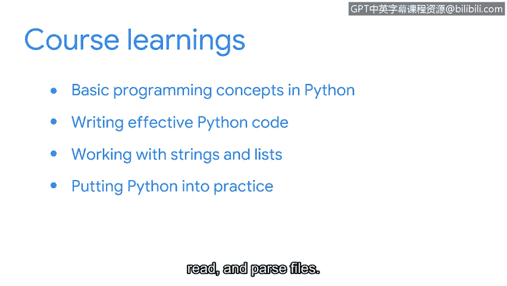

# 谷歌网络安全专业证书第七课：《用Python自动化网络安全任务》（中英字幕，前面分p中字，后面分p英字） - P80：39_01_course-wrap-up.en_subtitled - GPT中英字幕课程资源 - BV1Dp4y1G759

As we wrap up this course， I want to congratulate you for your commitment to learning Python。

You should feel accomplished having explored a programming language that's useful in the security field。

 Let's re up some of what we've learned， first。😊，We covered basic programming concepts in Python。

We discussed variables， data types， conditional statements and iterative statements。

These topics provided important foundations for what we explored later in the course。

And our next focus wasn on writing effective Python code。

We learn how we can reuse functions in our programs， to improve efficiency。

We explored building functions and even created our own user defined functions。

Another topic was modules and libraries。The pre package functions and variables they contain can make our work easier。

Last， we learned ways to ensure our code is readable。In the next section。

 we focus on working with strings and lists。We learned a variety of methods that can be applied to this data type。

We also learn about their indices and how to slice characters from a string or elements from a list。

We put all of this together to write a simple algorithm。

And then we explore how regular expressions can be used to find patterns in the strings。And last。

 we wrap up the course with a focus on putting Python into practice。

We learned how to open grid and parse files。

With these skills， you can work with the variety of logs you'll encounter in a security setting。

We also learned how to devo code。This is an important skill for all programmers。Wow。

You learn a lot about Python in this course。 So great job。

 I hope soon you'll join me in using Python in the security profession。😊，And in the meantime。

 I encourage you to practice and feel free to rewatch these videos whenever you like。😊。

The more you study these concepts， the easier they will become。Thanks again for joining me。

 as we explored Python。