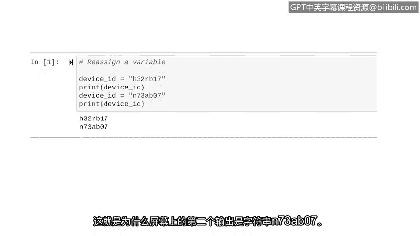

# 谷歌网络安全专业证书第七课：《用Python自动化网络安全任务》（中英字幕，前面分p中字，后面分p英字） - P8：7_在Python中使用变量.zh - GPT中英字幕课程资源 - BV1Dp4y1G759

Previously， we compared data types to the categories we have for different ingredients we use when cooking。

 like vegetables or meat。Some of these categories we use for data types are string。Float， integer。

 bulloleion and list。Now， let's make another comparison。 When working in the kitchen。

 we also use the storage containers。These containers can hold a lot of different things。

 After one meal， a container might hold rice， and after another。

 it could hold something different like pasta。In a similar way， in Python， we have variables。

A variable is a container that restores data。To create a variable， you need a name for it。

 Then you add an equal sign， and then an object to stor in it。

Creating a variable is often called assignment。The best practice for naming variables is to make the names relevant to what they're being useful。

Let's use a variable to store a device ID。We name our variable device I D。Are they equal equal sign？

And then assign it a value of H 3，2， R， B1，7。Because the data type for this variable is a string。

 we'll place that value in quotation marks。Let's run the code。Our variable is now saving to Python。

The purpose of creating variables is to use them later in the code。

Using variables can also be referred to as calling them。To call a variable， you type its name。

This tells Python to use the object that the variable contains。

 Let's add to the code we've just written and called a variable。

 Let's just have it print the variable。To do this， we use the print function and ask it to print the value stored in the device I D variable。

When using a variable in our print function， we don't use quotation marks。This time when we run it。

 something happens。Python prints H 3，2， R B1，7 to the screen。

Let's add one more line of code to demonstrate the difference between printing a variable and printing a string。

We'll ask Python to print a string that contains another device ID。M5，0， P I 3，1。

Because this is a string data and not a variable， we place it in quotation marks。Now。

 let's run the code and see the results。It executes both printed statements。

The first reads the variable and prints the value it contains H 3，2， R， B 1，7。

And the second reads the specified string and prints M5，0， P I 3，1。

But if we could use this string directly。Why do we need variables？Well。

We often use variables to simplify our code or make it cleaner and easier to read。

Or if we needed a very long string or number。stororing it in a variable would let us use it throughout our code without typing it all out。

In the previous example， the variable is stored to string data with variables can store a variety of data types。

 Vaables have the data type of the object currently storing them。

If you're unsure about the data type of store inside of a variable， you can use the type function。

The type function is a function that returns the data type of its input。

Let's use the type function in Python。We'll start by creating our variable。

Then we'll add a line of code that includes the type function。

This line asks Python to tell us the data type of the device ID variable。

And to assign these to a new variable called data type。After this。

 we can print the data type variable to the screen。😊，Perfect。

 Python tells us that the value that device I D contains is a string。When working with variables。

 it's important to keep track of their data types。 If you don't， you could get a type error。

 A type error is an error that results from using the wrong data type。For example。

 if you try to add a number and a string。You will get a type error because Python cannot combine those two data types together。

 It can only add two strings。Or two numbers。Let's demonstrate a type error。First。

 will we use our device I variable that restore the string value。

Then we'll define another variable called number and assign an integer value to it。

Let's start print a statement that outputs the sum of these variables。And then， we'll run this。

We ended up with an error because we cannot add a string to a number。

Let's cover one more topic related to variables。Earlier。

 we mentioned how variables are like containers。What they called can change。

After we define a variable， we can always change the object inside of it。

 This is called reassignment。Reassigning a variable is very similar to assign it in the first place。

Let's try this out and reassign a variable。We'll start by assigning the same string of H32 RB17 to our variableable device IDd。

Well also include a line of code to print this variable。Now， let's try reassigning the variable。

We type these variabless name。A an equal sign， and then add the new object。 In this case。

 we'll use the string n 7，3， A， B， C or 7 as the new device I D。

We'll also ask Python to print the variable again。Let's see what happens when we run this。

Python prints two lines of output。The first printed statement came before reassignment。

 so it first prints the string of H3，2， RB17。But the second printed statement came after it changed。

That's why the second output to the screen is the string and 7，3 A B，0，7。

With this code， we reassign a variable with a string value to another string value。

 but it's also possible to reassign a variable to a value of another data type。 For instance。

 we can reassign a variable with a string value to an integer value。

Variables are an essential part of Python。 And as we progress through this course。

 you'll become more familiar with them。