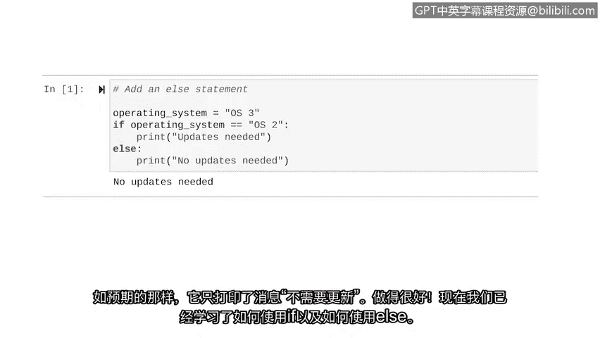

# 谷歌网络安全专业证书第七课：《用Python自动化网络安全任务》（中英字幕，前面分p中字，后面分p英字） - P9：8_Python中的条件语句.zh - GPT中英字幕课程资源 - BV1Dp4y1G759

Previously， we discussed how to store different data types in variables。 Now。

 we'll begin to move into the concept of automation。So we can create exciting actions with code。

Automation is the use of technology to reduce human and manual effort to perform common and repetitive tasks。

It allows computers to do these tasks for us so that we may get back more time in our lives to do other activities。

Conditional statements are important for automation。 A conditional statement。

Is a statement that evaluates code to determine if it meets a specified set of conditions。

The keyword if is important in conditional statements。If it starts a conditional statement。

After this keyword， we then specified the condition that must be met and what will happen if it is。

 We use if statements every day。 for example， if it's called outside。Then we'll wear a jacket。

 Or if it's raining。We'll bring an umbrella。If the statements are structured with the condition we want to evaluate。

And the action that a Python will perform， if this condition is met。

Python always evaluates if the condition is true or false。And if it's true。

 it performs the specific action。Let's explore an example of this。

Will instruct Python to print an account loggged message any time the fail login attempts are greater than 5。

 Our keyword if tells Python to start a conditional statement。After this。

 we indicate the condition we want to check for。In this case。

 we're checking if the user has more than five fail login attempts。

Notice how we're using a variable called failed attempts。In our complete code。

 we will have assigned a value to failed attempts prior to this if a statement。After this condition。

 we always place a column。These signals that what follows is what we want to happen when the condition is met。

In this case， when the user has more than five fail login attempts。

 it prints a message that the account is locked。In Python。

 this message should always be indented at least one space in order to execute only when the condition is true。

It's common to call this first line， the heather。And to call the actions that happen when the condition is met。

The body。This condition was based on a variable being greater than a specific number。

But we can define our condition using a variety of operators。For example。

 we can also check if something is less than a specified value。

Or we can check if it's greater than or equal2 or less than or equal2 the value。

We can also compare if something is equal to a value。When we do this inside a conditional。

 we need to use a special syntax。It's not just the equals sign， but a doubleable equals。

The double equals sign is an important operator often used in conditional statements。A double equals。

 evaluates whether two objects match。It assigns a boolean value of true when they match and false when they don't。

There's one more operator。 we should discuss。An exclamation mark， followed by an equal sign。

 represents the condition of nor equal。This operator， for not equalal。

 evaluates whether two objects are different。It assigns a Boolean value of true。

When they don't match and false when they match。Let's more closely investigate an example that uses the double equal sign。

Willll focus on an example that prints an updates needed message when a particular operating system is running。

Here， we've created a condition that checks if a device's operating system matches a specific string that identifies this operating system。

To do this。We'll need to use the double equals sign in our condition。When it matches。

 our program will print a message that there are updates needed。

The operating system variable is on the left of the double equal sign。The string OS2 is on the right。

If the condition evaluates to true， it performs the action that is indented in the next line of code。

Here。😊，If the operating system is OS2， it will print updates needed。If it's false。

The message will not print。Notice how this line is indented。😮。

This tells Python that the task depends on the if a statement evaluating to true。Now。

 let's write code that incorporates this conditional and get the results。

Before we write the conditional statement， we need to assign a value to our operating system variable。

Will make this value the same as the operating system that will check for in the conditional。Next。

 we'll write the condition for our EA statement and use the double equals sign to check if the operating system variable is equivalent to OS2。

Now， we'll type the action that will execute if the condition on the previous line evaluates to true。

We'll tell Python to print a updates needed message。

 Since we set our operating system variable to O2， the printer statement will execute。Okay。

 let's run this。As expected， it printed updates needed because the value assigned to the operating system variable was equal to OS2。

Sometimes we want our conditional statements to execute another set of instructions in the event our first condition isn't true。

In our example， not being true means that the device is running an operating system other than OS2。

This is when we need to incorporate the L keyword into our conditional statements。

Else precedes a code section that only evaluates when all conditions that preceded within the conditional statement evaluate to false。

Elsea's statements always follow an ifA statement and end in a column。

 Let's use our previous conditional and add an El statement to it。

We've included the same Efa statement。But this time。

 we set the operating system variable to contain a different operating system， OS3。

Because this doesn't match the value in the condition of the if statement。

 the updates needed message won't print。But we can add an else statement and tell it to do something else instead。

We type the L keyword， followed by a column。Then we indent the next line and tell it to print a no updates needed message。

When we run this code， it processes the ALSE statement after the EFA statement。

Since our if statement will evaluate to false， it then moves on the else instruction。Let's try it。

As expected， it only prints the message， no updates needed。

Great work。 Now， we've covered how to use if and how to use else。

Using conditional statements allows you to incorporate logic into your code。

