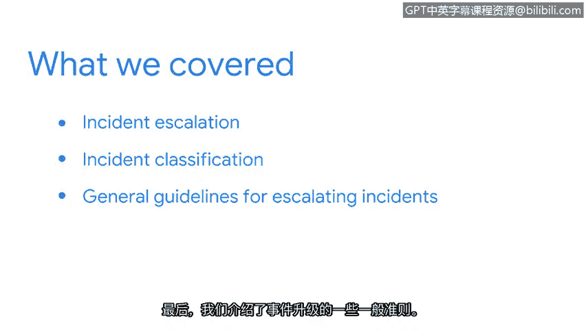

# 谷歌网络安全专业证书第八课：《投入实践：为网络安全工作做好准备》（中英字幕，前面分p中字，后面分p英字） - P12：11_总结.zh - GPT中英字幕课程资源 - BV12x4y1X7h8

Now， you've had an opportunity to learn about the essential role you'd be playing by escalating incidents。

Let's review what we've covered in this section of the course。

 We started off by defining incident escalation and discussing useful traits needed to properly escalate incidents。

 We also explored a few incident classification types， and their potential impacts an organization。

 From there， we discuss how small security incidents can become bigger problems。

 if not properly address。Finally， we covered some general guidelines for the actual process of incident escalation。

😊。

This process varies depending on the organization you work for。

 but one thing should always remain the same。Your attention to detail。

Understanding how each incident affects the data and assets of an organization is really important。

Because the decisions you make can affect the entire security team and organization。

Are you ready to continue your security journey？Coming up。

 we'll discuss stakeholders and how to communicate effectively with them。

