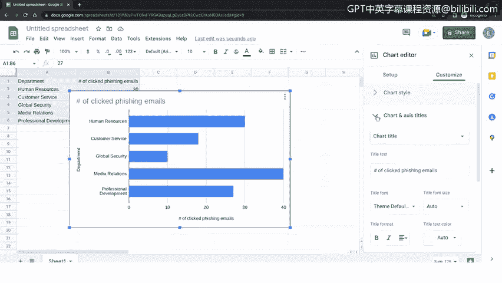

# 谷歌网络安全专业证书第八课：《投入实践：为网络安全工作做好准备》（中英字幕，前面分p中字，后面分p英字） - P18：17_如何创建视觉仪表板.zh - GPT中英字幕课程资源 - BV12x4y1X7h8

In this video， we're going to have a bit of fun。😊，We'll create a visual security story。

Here's the scenario。 The operations manager， one of the stakeholders we previously discussed。

 has been informed that the chief information security officer， also known as the Csso。

 wants to know how many employees are often clicking on phishing emails。

 The goal is to identify which five departments click on those emails most often。

An investigation reveals that the five departments that most frequently click on phishing emails are human resources。

 customer service， global security， media relations and professional development。

Based on this information， the security team can create a visual representation of the data to share with the operations manager and the CO。

Those stakeholders and the security team can then work together to determine how to address the issue。

There are many different platforms available that can be used to create and share visual stories of data。

Apache Open Office is a free open source office suite that allows users to create spreadsheets and other visual representations。

😊，Another no course option is Google Sheets。Today， we'll enter our data into Google Sheets。

 Then we'll create a bar chart visualization to develop the data story。😊。

If you don't have a Google account， you will need to create one。😡。

Let's start by demonstrating how to create an account。First。Go to Google。com and click on sign in。😡。

Click， create account and select for my personal use。😡。

Then complete each step to create your personal account。😡。

Now that you've created your Google account， it's time for us to begin creating our Google She's bar chart visualization。

Click the dots menu in the top right corner。😡，Click the Shes icon。

Click blank to start a new spreadsheet。Select， sell a1 type department。

Select cell B1 type number of clicked phishing emails。Select sell A2 type human resources。

Select cell B2， type 30。Select sell a 3， type， customer service。Select cell B3， type 18。

Select cell a4 type global security。Select cell B4， type 10。Select sell A5 type media relations。

Select cell B5 type 4，0。Select， sell Asics， type professional development。Select cell B6， type2，7。

Then select the rows and columns containing headers， department names， and data。

Click inserts at the top of the sheet。Select chart in the Char editor menu。😡。

Click Char type drop down menu。Scroll down to the bar chart options， then select the first bar chart。

😡，In the chart Ed menu， clickCustomize。😡，Then click on the chart and access title section。Now。

 update the title to read something like。

Clicked phishing emails by departments。Or another title related to the data。

Then click on the X icon at the top of the chart editor to close the editor menu。

Great job creating your first visual security story。😊。

Creating visual stories of data allows security team members to convey essential information to stakeholders。

 so issues can be communicated in a meaningful and understandable way。😊。

These data stories can also help promote a better understanding of issues that exist within an organization and allow decision makers to determine how to address security issues that put the organization at risk。

