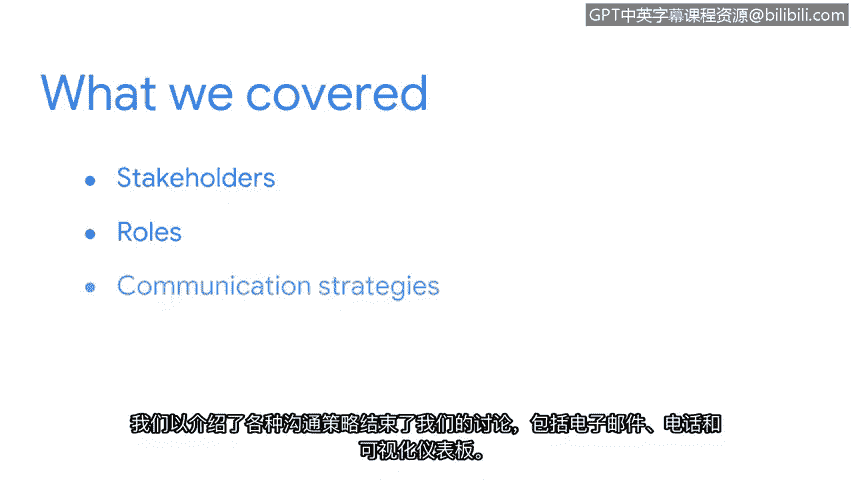

# 谷歌网络安全专业证书第八课：《投入实践：为网络安全工作做好准备》（中英字幕，前面分p中字，后面分p英字） - P19：18_总结.zh - GPT中英字幕课程资源 - BV12x4y1X7h8

You've had an opportunity to learn about the important roles stakeholders play and different ways to communicate with them。

Let's review what we covered。We started by defining stakeholders and their roles in protecting an organization。

We also explore the sensitive nature of communications with stakeholders and the importance of sharing that information with care and confidentiality。

😊，Then we discuss information that needs to be communicated to stakeholders。After all。

 stakeholders are extremely busy， so we only want to share relevant information that they need to be aware of。

😊，We ended our discussion by introducing various communication strategies， including emails。

 phone calls and visual dashboards。😊。

Understanding who the stakeholders are within your organization and how to communicate with them will help you throughout your career as a security professional。

 Be intentional about the strategies you use to communicate。

Remove unnecessary details from your communications and be specific and precise when relaying information to stakeholders。

Stakeholders are depending on you， as a story telleller to tell them the security story or the potential issues and solutions in a way that makes sense。

 The communication strategies we discussed will help you stand out as someone who has a combination of technical and transferable skills。

Coming up， your instructor for the final sections of this course， Emily。

 will discuss a few ways to engage with the security community and how to find and apply for jobs in the security field。

