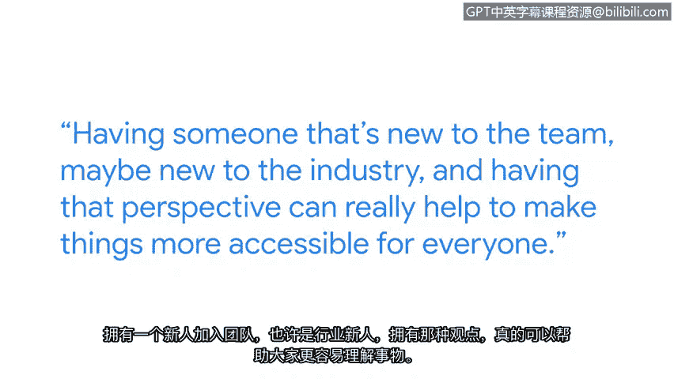

# 谷歌网络安全专业证书第八课：《投入实践：为网络安全工作做好准备》（中英字幕，前面分p中字，后面分p英字） - P22：21_维多利亚：继续你的学习之旅.zh - GPT中英字幕课程资源 - BV12x4y1X7h8

I'm Victoria， I'm a security engineer at Google When I first applied for a cybersecurity job。

 I felt overwhelmed I was not a traditionally educated and computer science applicant。

 I was actually majored in biology so anytime recruiters saw my resume I would kind of get this little like fear that they would see that。

Bio major and say， like， why are you even applying just immediately disregard my resume？

I would consider the team that I work on to be very diverse。

 we have a lot of different people from different backgrounds。

 one of the benefits that I feel from having a diverse team is that you can have these different perspectives on a problem that if all of you have the same background for。

 you might not come up with this new solution， having someone that's new to the team maybe new to the industry and having that perspective can really help to make things more accessible for everyone。

It's important to continue to learn in the field of cybersecurity because things change all the time。

 What was once a big threat a few years ago might not be the same as it is for today。

 trying to keep pace with how things are changing all the time is something that is a core part of my job role to support my continued education and security。

 I take courses， try to get certificates if I can along the way。

 but a lot of it's just keeping up on current industry news。

 whether that be a new blog post about a breach that has happened or a detailed analysis of a new malware that has been released。

 try to keep at least a surfaceest level knowledge of the different trends in the industry。

 I often go to besidesides。Conferences， these are smaller locally organized conferences so you have more of a chance to interact with your local security community。

 which is something you wouldn't get at a huge conference like say Decon or black hat meaning people locally is a great way to see what's out there in your area and meet other folks that are local that you can talk to more consistently that are also interested in security Before I gone to my role I wish that I knew that was okay that you don't know everything you don't have to know everything。

 you have teammates and other people that can help you with areas that your weekend so don't feel stressed if you don't know everything that is about security because no one does working in security is a lot of fun a lot of things can happen。

 it's never the same day to day so if you like things that are dynamic and always changing than security is the right field for you。

