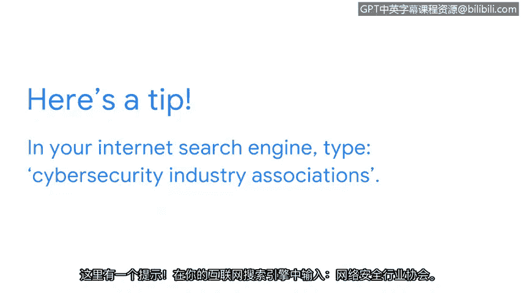

# 谷歌网络安全专业证书第八课：《投入实践：为网络安全工作做好准备》（中英字幕，前面分p中字，后面分p英字） - P23：22_与网络安全社区进行有意义的互动.zh - GPT中英字幕课程资源 - BV12x4y1X7h8

Earlier， we discussed the importance of staying up to date on security trends and news In this video。

 we're going to share ways to establish and advance your career in security by connecting with people who are already in the industry。

 Social media is a great way to connect to other security professionals in the industry。😊，However。

 it's important to be mindful of the information you share on your social media page and when responding to messages from people you don't know。

With that in mind， let's discuss ways to effectively use social media to establish or advance your security career。

One way to use social media is to follow or read the posts of leaders in the security industry。

Chief information security officers， for example， are great individuals to follow。

They often post interviews they've done in the security space and share articles they've read or contributed to。

Here's a question you might be asking yourself。 How can I find Csos to follow on social media。

 The best way would be to conduct an internet search for the name of the Cso of a popular organization or an organization you're interested in working for。

After you find their name， you can simply go to a social media site to look them up。Ideally。

 you want to use LinkedIn when following security professionals。

 That's because the LinkedIn platform focuses on connecting professionals with other professionals in the same or similar field。

Another way to use social media to establish or advance your career in the security industry is to connect with other security analysts currently employed in the field。

On social networks like LinkedIn， you can find security professionals by searching for cybersecur analysts or a similar search term。

 then filtering for people and people who talk about hashtag cybersecur。

 Once you've found other professionals you'd like to connect with。

 you can send to connection request with a brief comment such as， hi。

 I'd like to connect to learn more about why you became interested in security and your experiences as an analyst。

😊，Additionally， you can set your filter to locate events and groups that focus on security related topics that interest you。

While social media platforms like LinkedIn are excellent for connecting with professionals。

 some people are more comfortable with being active on social media than others。

For those of us who aren't very active on social media。

 there are other ways to connect with security professionals or find mentors in the industry。

Joining different security associations is a good way to connect with others。

There are many associations out there。 So you're going to have to do a little bit of research to find the best ones for you。

Here's a tip。In your Internet search engine， type cybersecurity industrytry associations。

 This search term will populate a variety of different associations。

 so be sure to select ones that align with your professional goals。

Now that we've discussed ways to engage with the security community。

 consider following a Cso on LinkedIn， connecting with other analysts or searching for cyberse organizations to join。

 That's all for now。 I'll meet you in the next video。😊。

