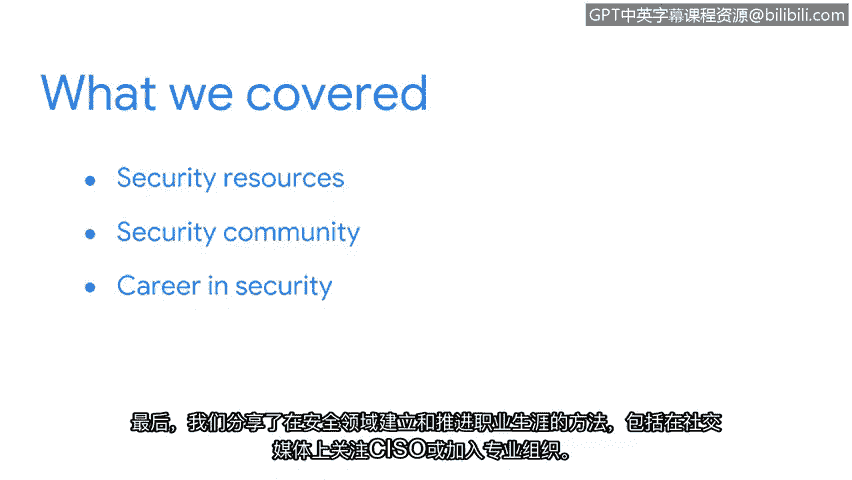

# 谷歌网络安全专业证书第八课：《投入实践：为网络安全工作做好准备》（中英字幕，前面分p中字，后面分p英字） - P25：24_总结.zh - GPT中英字幕课程资源 - BV12x4y1X7h8

Great job。 Now， you had an opportunity to learn about different ways to stay engaged with the security community。

😊，Let's take a moment to review what we've covered。First， we identified reliable security resources。

Then we discuss different ways to engage with the security community。

We also explored the usefulness of social media to connect with other security professionals and stay informed about current topics of interest。

Finally， we shared ways to establish and advance a career in security。

 including following a CISO on social media or joining a professional organization。

We've come a long way in this journey。 You should be proud of your progress and how far you've come。

 I'm certainly proud of you in the final section of this course。

 We'll take the time to prepare you for the job search and interviewing process。

 How exciting is that。😊。