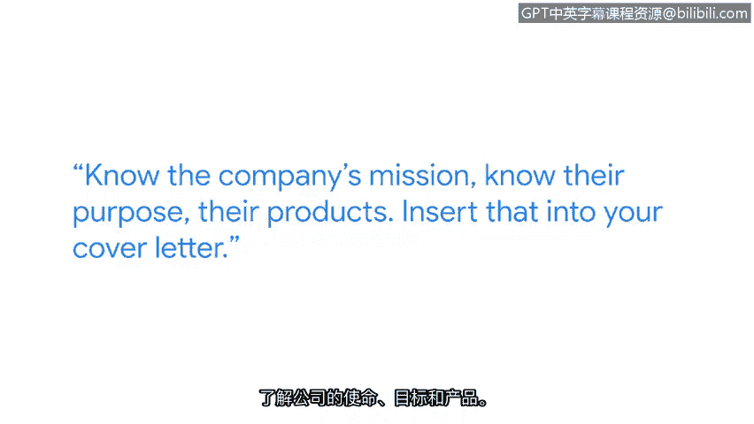

# 谷歌网络安全专业证书第八课：《投入实践：为网络安全工作做好准备》（中英字幕，前面分p中字，后面分p英字） - P29：28_加维：求职信技巧.zh - GPT中英字幕课程资源 - BV12x4y1X7h8

。

My name is Garvey。 I'm a global staffing manager here at Google。

 I hire essentially all the cybersecurity engineers here at Google。 I've hired across the US Zurich。

 London， Sydney， Australia and know virtually any office that you name this space is unique in the sense that it's growing it's vastly evolving。

 you have a number of candidates that have pivoted。

 change positions in their life come from all different walks of life right So cover letters is opportunity for you to tell that story a resume tells me the facts。

 what have you done， but a cover letter tells me who you are， why cybersecurity， why this space。

 why this opportunity， you know what what draws you here。

 Most folks that I've met that want to enter this space have a reason either they've been。

The the victim of some sort of cyber crimeime or they know others who have or they've seen something that has affected them in their lives that has brought them to that moment。

 I want to know more about that。 I want to understand what your passion is。

 what your interest is in this space。 So I think in particular when it comes to cybersecurity when it comes to cover letters。

 it's your opportunity to tell me kind of what's written in between those lines of that resume that's brought you here How long should a cover letter be。

 I mean， I don't think there's any perfect science to that。 first give me。

 know a few lines about yourself， your family， your hobbies。

 and then after that really kind of cut to what makes you unique。

 What makes you different than this other applicant。 What what has brought you to this opportunity。

 how have you overcome adversity and how do you plan to do so in this work environment。

 What does this job mean to you。 What are the soft skills that you can present and bring to your colleagues in this role if I'm in Canada that's making a career transition。

 I want to know in that cover letter why I there particular reason cybersecurity excites you。

 is there particular reason you're making this。What have you found in your previous career？

 I want you here forever I can keep you here forever。

 I want to keep you happy So what makes you happy， what are the things that you see in this space that are gonna excite you that you passionate about I want to see that written in the cover letter。

 Don't sort of standardize your cover letter and just fire it off regardless of the company that it is tailor your cover letter around that mission what's their mission make it a part of your own。

 know the company's mission， know their purpose， their products insert that in your cover letter。

 a cover letter is meant to capture someone's attention quickly You can imagine to capture the attention of someone for the entirety of what you've written So what is it about you that interest me that brings you to this time and this opportunity You want to capture someone's eye first and then capture their attention in their mind So be bold。

 be loud I think keep the words simple， but like be bold。

