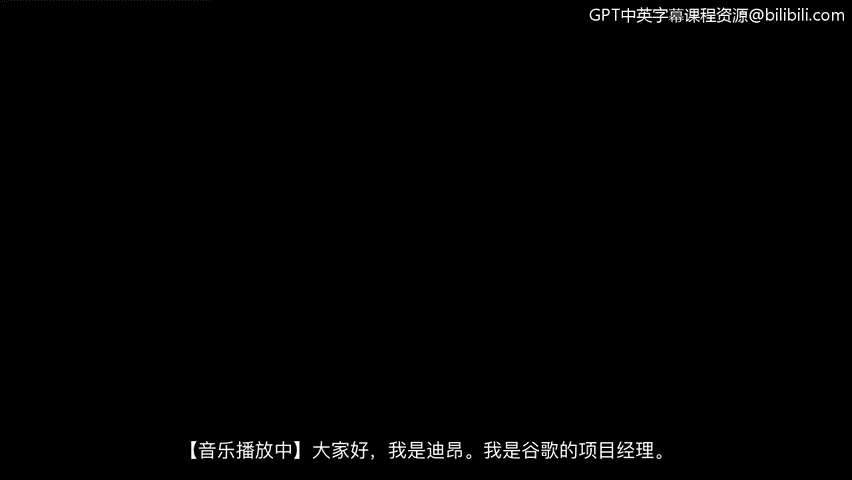
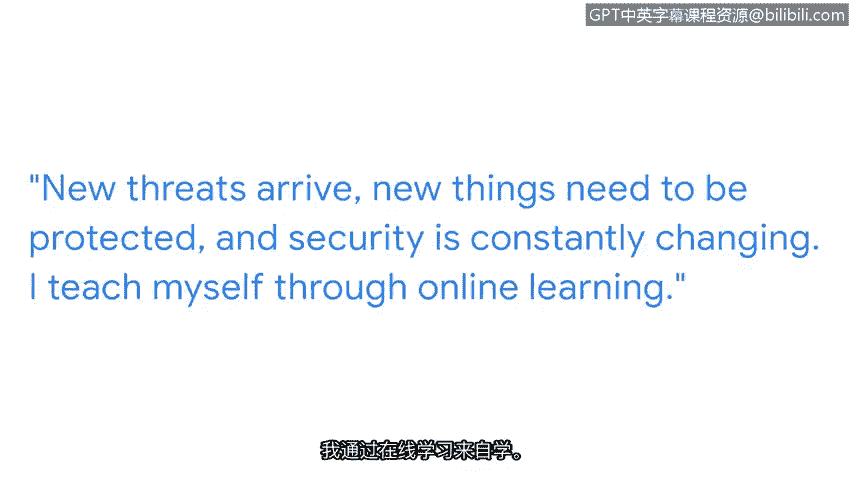

# 谷歌网络安全专业证书第八课：《投入实践：为网络安全工作做好准备》（中英字幕，前面分p中字，后面分p英字） - P2：1_迪昂：我的个人职业之旅.zh - GPT中英字幕课程资源 - BV12x4y1X7h8

Hi， I'm Dion。 I am a program manager at Google。 I am a part of the detection and response team。

 which falls under the privacy， Safety and Security organizationgan。

 My favorite part of my job is understanding that there are threats that we encounter day by day。

 and my team helps ensure that we can find those threats and respond to them accordingly。

 cybersecur is very important。 just as we need to keep ourselves physically secure。😊。

We need to keep our information online， safe and secure。 So whenever you use a computer or a device。

That data。Live somewhere online。And you trust Google and other companies to secure that data and keep it private only to you。

 The work that I do day by day ensures that your information。

 your data and the world's information stays secure and stays private and protected。

 I've held many jobs in different areas before getting involved in cyberse。

 One of those jobs is serving as a radio DJ and online personality。

Which has not much to do with security。One of the key things I got from that was to keep the music playing。

No matter what happens。Keep the music playing。I am also a proud father。

 My kids are my greatest assets， and I have to protect them。

 The allot of threats and risks associated with them， even vulnerabilities， as a security guy。

 I have to protect the information that I' am tasked withhold from threats risks and vulnerabilities。

 As a security professional， fires would come up。 you have to find a way to keep things moving。😊。

Either escalating to the right team。Or escalating up the chain to find a resolution。

 So having not been formally trained in security， I am tasked with teaching myself new things daily。

 New threats arrive。 new things need to be protected， and security is constantly changing。

 I teach myself through online learning are subscribe to and read to lots of journals related to security knowledge。

 And I'm also taking some security courses online as well。 I think the most challenging part。

 about an entry level role in security。

Is not knowing what you don't know When I first got involved in security， I was really winging it。

 But the one thing that I did was always reach out to my team for support。

Getting stuck is a part of the process， we could always lean on our team and others for additional support or to help us get unstuck。

