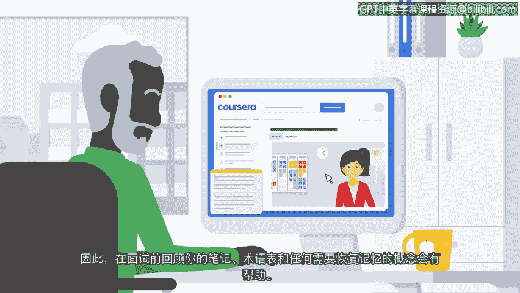

# 谷歌网络安全专业证书第八课：《投入实践：为网络安全工作做好准备》（中英字幕，前面分p中字，后面分p英字） - P30：29_探索面试流程.zh - GPT中英字幕课程资源 - BV12x4y1X7h8

After you've submitted your resume to several job postings。

 you'll hopefully get an opportunity for an interview。

The interview process usually starts with a short pre screening phone call。

 It typically involves having a 15 minute conversation with a hiring manager or recruiter who will ask you some questions to make sure that you are who your resume says you are and that you meet the minimum requirements for the job。

Following the pre screening， you could be invited to an in person interview。

 either on site or online。This could be a panel interview with a few members of the team that you would be working with or a one on one interview。

Let's discuss some strategies that can help prepare you for an interview。

Review the job description and your resume ahead of time。

Practice speaking about the experiences and skills that the employer is looking for。

Consider practising this with a friend by participating in a mock interview。

 Your friend will act as the interviewer， and you will answer their questions as if yourre meeting with the employer。

It can also be helpful to dress professionally and feel comfortable in the clothes you choose to wear for the interview。

Before the interview begins。Take a few deep breaths and remind yourself of all the preparation you've done。

If the interview is online via video conference， prepare a location in your home that is quiet。

 tidy and professional。Also， be sure to test your video and audio settings and if necessary。

 download the video conference application specified by the interviewer。

This will help ensure that you correct any technical issues before the interview。

Interviews usually include two parts， a background interview and a technical interview。

The background interview will likely include questions about your education， work experience， skills。

 and abilities。You might even be asked some personal questions unrelated to the job posting。

The interviewer is trying to get to know you to determine if you'll be a good match for the team and company culture。

At the same time， you want to ask questions to help you decide if the team and company culture are a good match for you。

The other portion of the interview is the technical interview。

 This is when the interviewer will ask you specific questions about technical skills related to the role。

You might be asked how you would respond to a specific situation or to explain a technical concept that's listed on your resume。

Do your best to answer these types of questions confidently and concisely based on your current knowledge。

It's O to say that you don't know the answer to a question or that you need a moment to respond so you can think about your answer。

Employers respect honesty。Just follow up with an explanation of how you would figure out the answer。

 either by researching it or collaborating with the team。

Even after you've completed this certificate program， you'll still have access to all of the content。

 So before the interview， go back and review your notes。

 the glossary and any concepts that you might need to refresh your memory on。

 This can help you feel prepared for the questions you'll be asked。

Remember， you can prepare for the interview by participating in a mock interview。

 reviewing the job description and taking a few deep breaths before the interview begins。

You've learned a lot in this course and are ready to move ahead and find a position as a security analyst。

Coming up， we'll discuss how to conduct pre interview research。

