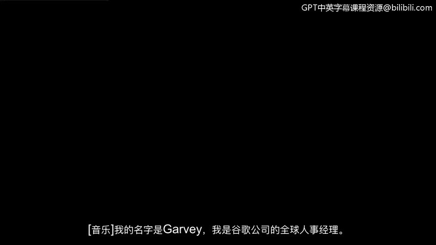

# 谷歌网络安全专业证书第八课：《投入实践：为网络安全工作做好准备》（中英字幕，前面分p中字，后面分p英字） - P31：30_加维：技术面试技巧.zh - GPT中英字幕课程资源 - BV12x4y1X7h8

。

My name is Garvey， I'm a global staffing manager here at Google I've hired。

 I would say several hundred security engineers here at Google over the last seven years advice I would give those that are preparing for their technical interviews don't expect that the interview will be a sort of trivial exam of how many questions can you answer in this sort of period of time。

 I want to know as an interviewer does the candidate understand the fundamentals and can they explain them back to me programs and applications that I would recommend preparing for when doing an entry levelvel interview for example。

 Splunk wire shark understanding their functions， their purpose if you can get to the point of understanding their internals。

 why they exist if they didn't exist how would you solve a problem outside of that。

 just understanding the fundamentals of topics that exist within this space network security web applications security knowledge operating system internals understanding and mastering security protocols I think that's。

Important place to start practice answering openend questions they tend to be really difficult。

 they're ambiguous by design， they're complex by design。

 you always want to start first by asking clarifying questions。

 get information from your interviewer to help you narrow down the focus of the question itself。

 but also，Sort of lower the scope of the problem and something that you can answer yourself that you know that you feel comfortable with。

 organize your answer through the star method。 It's a great way to organize yourself when faced with a large open entity question。

 it'll help your interviewer understand your train of thought thinking out loud as well will help your interviewer understand okay this is where Garby's going with this answer。

 if I need to help him I can help him maybe he doesn't get the entire answer。

 I know he was on the right track because he was thinking out loud。 I understood where he was going。

 you don't know the answer that's fine again， no one expects you to walk on water。

 but we don't expect you to lie if you will my ideal candidate is someone who just loves to learn someone that's humble honest someone that can manage to ambiguity。

 complexity in their own life。 this necessarily have to be directly related to cybersecurity。

 but someone that when faced with the problem runs towards it they're always a student' always learn they're the mentor。

 lead others they demonstrate this。

Characteristics throughout their lifenererves during technical interviews。 I think that's。

 that's pretty standard。 It's okay to be nervous， right， I think it it means you care。 There's。

 there's a reason you're there。 There's a reason youre， you find yourself in that moment， right。

 Someone has counted you and already。 they have belief in you。 And this， this space needs you。 So。

 you know， I would say trust yourself， trust your gut。 Don't be afraid to fail。😊。

