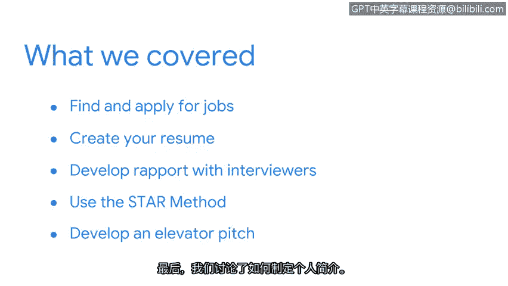

# 谷歌网络安全专业证书第八课：《投入实践：为网络安全工作做好准备》（中英字幕，前面分p中字，后面分p英字） - P39：38_总结.zh - GPT中英字幕课程资源 - BV12x4y1X7h8

You've done a great job completing this section of the course。

 Let's take a moment to review what we've covered。 We started by discussing how to find and apply for jobs in the security field。

😊，Then we explored how to create your resume。Next， we shared some strategies to develop rapport with interviewers。

We also covered how to use the ST method to answer open ended interview questions thoughtfully。

We finished by discussing how to develop an elevator pitch。

Hopefully， this has helped you feel confident as you begin to search and apply for jobs in the security field。

 Good luck。😊。

