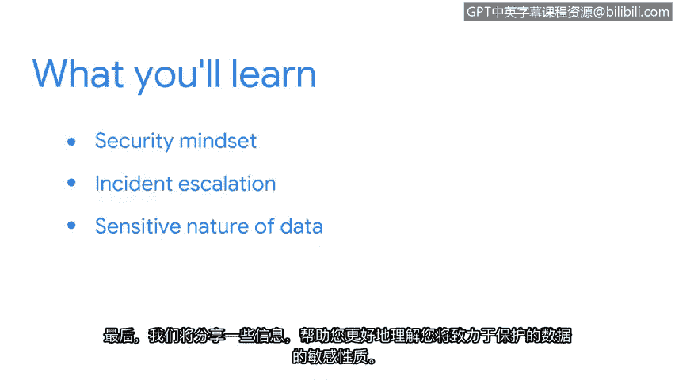

# 谷歌网络安全专业证书第八课：《投入实践：为网络安全工作做好准备》（中英字幕，前面分p中字，后面分p英字） - P3：2_欢迎来到第一周.zh - GPT中英字幕课程资源 - BV12x4y1X7h8

Welcome to the first section of the course。 In the next several videos。

 We'll discuss what it means to have a security mindset and how we'll use that mindset to protect an organization's assets and data。

 Then we'll explore the process of incident escalation in the event of a breach。 Finally。

 we'll share information to better help you understand the sensitive nature of the data that you'll work to protect。

😊。

Coming up， we'll focus on how to develop a security mindset。

 then use that mindset to protect organizations and the people they serve。

