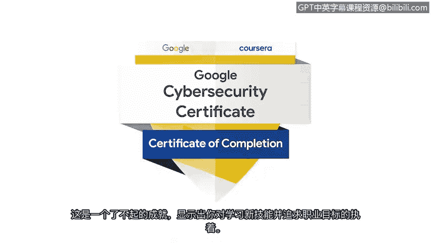

# 谷歌网络安全专业证书第八课：《投入实践：为网络安全工作做好准备》（中英字幕，前面分p中字，后面分p英字） - P42：41_祝贺你完成谷歌网络安全证书项目.zh - GPT中英字幕课程资源 - BV12x4y1X7h8

You just completed the Google Cybersecurity certificate。

 What a remarkable accomplishment that shows just how committed you are to learning new skills that will allow you to pursue your career goals。

😊。

On behalf of myself and my fellow course instructors， congratulations。😊，Congratulations， you did it。

 congrats。 I can't wait to see how many of you decide to pursue this career and visit some really cool places in cybersecurity。

 to gogratulations congratulations're rock star。 Congratulations Congratulations Great job。

 you did it。 Congratulations。 Congratulations I am rooting for wishing you continued success congraulations your accomplishment it's to to is probably one of the best decisions you've ever made and I can't to all the opportunities you're gonna experience congraulations congratulations've made the end you're ready to keep everyone Congratulations continue to learn。

 continue to grow。 You'll find this is a very rewarding career。 Congratulations you did it。

 We to cyberse。 The adventure continues after this's still a lot more in the world security。

 but you're。😊，start It's been my pleasure guiding you through the final part of this program。

I know you're well prepared to begin or continue a remarkable career in security。

Congratulations and best of luck on your journey。😊。

