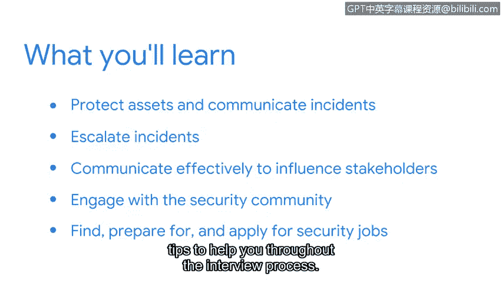

# 谷歌网络安全专业证书第八课：《投入实践：为网络安全工作做好准备》（中英字幕，前面分p中字，后面分p英字） - P43：0_01_introduction-to-course-8.en_subtitled - GPT中英字幕课程资源 - BV12x4y1X7h8

Hello and welcome to the course。 I am Dion， a program manager at Google。😊。

I've worked in security for the past five years in areas ranging from risk management to insider threat detection。

I'll be your first instructor in this course。😡，As a security analyst。

 you will help protect the assets of the organization you work for。

 including tangible or physical assets such as software and network devices。

As well as intangible assets like PII， copyrights and intellectual property。

Imagine if this kind of sensitive information were to be exposed by a threat actor。

 It would be devastating to the reputation and financial stability of the organization and the people the organization serves。

In previous courses， we discussed a variety of topics that are relevant to the security profession。

 including core security concepts。Freeworks and controls， threats， risks and vulnerabilities。

Networks， incident detection and response and programming basics。

Now it's time to put all of these core security concepts to practical use。In this course。

 we'll further explore how to protect assets and communicate incidents。

Then we'll discuss when and how to escalate incidents to protect an organization's assets and data。

We'll also cover how to communicate effectively to influence stakeholders decisions related to security After that。

 Emily， your instructor for the second part of this course will introduce some reliable resources that will help you engage with the security community after you complete the certificate program and finally we'll cover how to find。

 preparepa for and apply for security jobs。 This will include discussions about how to create a compelling resume and tips to help you throughout the interview process。

😊。

When I started my first security base role， I was excited to be hired at Google to protect information and devices。

😊，I was also happy to be a part of a broader team that I could learn from and reach out to for support。

My team helped me grow my expertise and I'm proud of my contribution to our projects。

By the end of this course， youll have had multiple opportunities to refine your understanding of key security concepts。

 createate a resume， build confidence in your interview skills and even participate in an artificial intelligence or AI generated interview。

😊，The security profession is such an amazing field， and I'm looking forward to you joining it。😊。

I have one question for you。Are you ready to get started？

