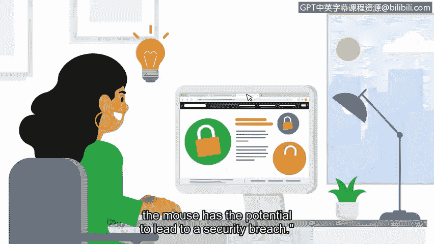

# 谷歌网络安全专业证书第八课：《投入实践：为网络安全工作做好准备》（中英字幕，前面分p中字，后面分p英字） - P46：3_02_security-as-a-mindset.en_subtitled - GPT中英字幕课程资源 - BV12x4y1X7h8

Let's take a little time to discuss a concept that would help you throughout your security career。

 having a security mindset。In previous courses， we discussed various threats。

 risks and vulnerabilities and how they can impact organizational operations and the people served by those organizations。

These concepts are key considerations when thinking about having a security mindset。

You'll have to recognize not only what you're defending， but what or who you're defending against。

 For example， it's important to recognize the types of assets that are essential to maintaining an organization's business functions。

 along with types of threats， risks and vulnerabilities that can negatively impact those assets。

 And that's what having a security mindset is all about。

A security mindset is the ability to evaluate risk and constantly seek out and identify the potential or actual breach of a system。

 application or data。E in the program， we discussed threats。

 risks and vulnerabilities that are posed by social engineering attacks， such as phishing。

These attacks are designed to compromise an organization's assets to help the threat a or actors gain access to sensitive information。

Using our security mindset can help prevent these types of attacks。

It's important that we're constantly staying up to date with the kinds of attacks that are happening。

To do this it's good to develop a habit of seeking out information regarding the latest security trends or vulnerabilities。

As you do this， new ideas for protecting company data may come to mind。

Securities an everyday objective for every security team in the industry。

 So having a security mindset helps analysts defend against the constant pressure from attackers。

 That mindset can make you think every click of the most has the potential to lead to a security breach。

That level of scrutiny， as a security professional， helps you prepare for the worst case scenario。

 even if it doesn't happen。Entry level analysts can help protect low level assets。

 such as an organization's guest Wifi network and high importance assets such as intellectual property。

 trade secrets， PII and even financial information。

Your security mindset allows you to protect all levels of assets。 However， if an incident does occur。

 that doesn't mean you respond to all incidents in the same way。

So we'll discuss incident prioritization a little later in the course。

Having a strong security mindset can help set you apart from other candidates as you prepare to enter the security profession。

It may even be a good idea to reference that foundation in future job interviews。

We'll discuss interview preparation in detail later in the course。Coming up。

 we'll focus on incident detection in greater detail。

