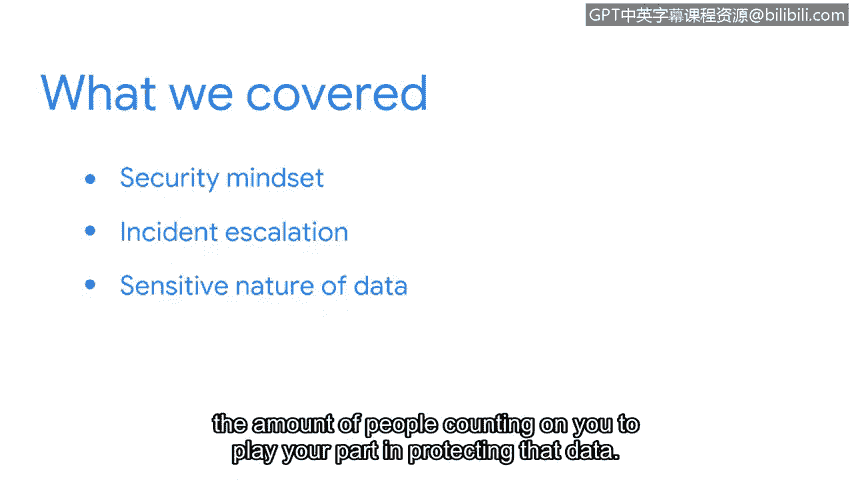

# 谷歌网络安全专业证书第八课：《投入实践：为网络安全工作做好准备》（中英字幕，前面分p中字，后面分p英字） - P48：5_01_wrap-up.en_subtitled - GPT中英字幕课程资源 - BV12x4y1X7h8

You've had an opportunity to learn more about the important role an entry level analyst plays in protecting the data and assets of an organization。

Let's quickly review what we covered。We started off by discussing the importance of having a security mindset。

 including how it supports incident detection。 Then we examine the relationship between incidents and events and further explore the incident escalation process。

We ended our discussion by exploring the sensitive nature of the data that you're protecting and the amount of people counting on you to play your part in protecting that data。

Understanding how valuable you are as a member of the security team can help you put the work you do into perspective。

Every rule in security matters。Each individual contributes to making a company's operations flow smoothly。

I hope you enjoyed our discussion as much as I did。

Are you ready to continue your journey into the security world？Coming up。

 we'll discuss the importance of escalating security incidents。

