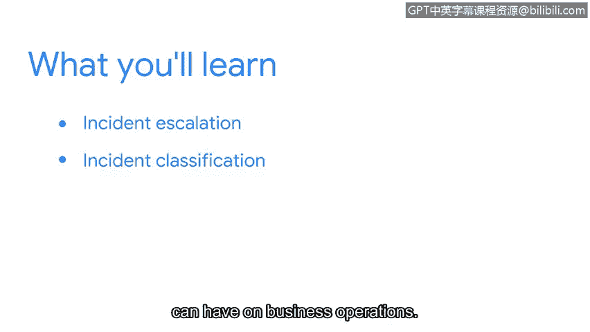

# 谷歌网络安全专业证书第八课：《投入实践：为网络安全工作做好准备》（中英字幕，前面分p中字，后面分p英字） - P49：6_01_welcome-to-week-2.en_subtitled - GPT中英字幕课程资源 - BV12x4y1X7h8

I'm excited that you could join me today。Previously。

 you learn about the importance of various asset types。

 You also learn about the relationship between incidents and events。

Now we'll focus on escalating those incidents and events to the right people。

Protecting the data and assets of an organization is the primary goal of a security team。

The decisions you make every day are important for helping the security team achieve that goal。

Recognizing when and how to escalate security incidents is crucial。

It helps ensure simple issues don't become larger problems for an organization。

Escalation is a term you should familiarize yourself with。

It's likely to resurface often as you continue your journey into the security profession。

In the following videos， we'll discuss incident escalation from an entry level analyst perspective。

Then we'll explore various incident classification types and the impact security incidents can have on business operations。

 Finally， we'll share some general guidelines for escalating incidents。😊。

Coming up， we'll start by focusing on incident inscalation and how it can be used to prevent a seemingly small issue from becoming a bigger problem。

Let's get started。