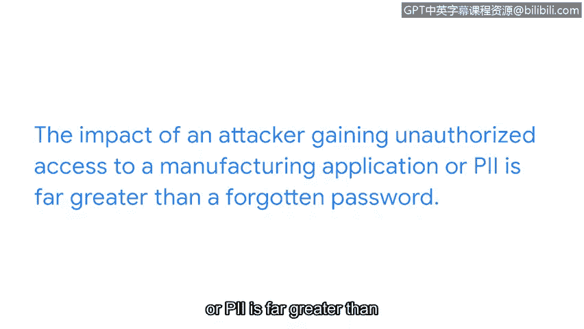

# 谷歌网络安全专业证书第八课：《投入实践：为网络安全工作做好准备》（中英字幕，前面分p中字，后面分p英字） - P52：9_01_from-simple-activity-to-major-data-breach.en_subtitled - GPT中英字幕课程资源 - BV12x4y1X7h8

So far， we've discussed different incident types and the importance of escalating those incidents to the right prison。

But what happens if an incident goes unescalated for too long？In this video。

 we'll discuss the potential impact that even the smallest incident can have in an organization if it goes unnoticed。

 Are you ready。Great， now let's take a journey into the life of our organization security team。😊。

It's been a quiet day for the security team。 Suddenly。

 you noticed there has been unusual log activity in an app that was recently banned from the organization。

😊，You make a note to mention this activity during the next meeting with your supervisor。

But you forget and never mention it。Following this same scenario， let's fast forward to a week later。

You and your supervisor are meeting again。But now， the supervisor indicates that a data breach has occurred。

This breach has impacted one of the manufacturing sites for the organization。Now。

 all operations at the manufacturing site have been put on hold。

This causes the company to lose money and precious time。Days later。

 the security team discovers that the data breach began with suspicious activity in the app that was recently banned from the organization。

😊，What we've learned from this scenario is that a simple incident can lead to a much larger issue。

 if not escalated properly。Incident criticality is also important to note here。Initially。

 an incident can be escalated with a medium level of criticality if the analyst doesn't have enough information to determine the amount of damage done to the organization。

Once an experienced incident handler reviews the incident。

 the incident may be increased or decreased to a high or low criticality level。

Every security incident you encounter is important to an organization。

 but some incidents are certainly more urgent than others。

So what's the best way to determine the urgency of a security incident。

It really depends on the asset or assets that the incident affects。For example。

 if an employee forgets a login password for their work computer。

A low level security incident may be prompted if they have repeated failed login attempts。

This incident needs to be addressed， but the impact of this incident is likely minimal。

In other instances， assets are critical to an organization's business operations。

 such as a manufacturing plant or database that stores PII。

These types of assets need to be protected with a higher level of urgency。

The impact of an attacker gaining unauthorized access to a manufacturing application or PII is far greater than a forgotten password。

😡。

Because the attacker could interfere with the manufacturing processes or expose private customer data。

I hope this video has helped you understand the importance of knowing the relationship between assets and security incidents。

 Later in this course， we'll share some new concepts related to escalation timing and why your role in that process matters。

