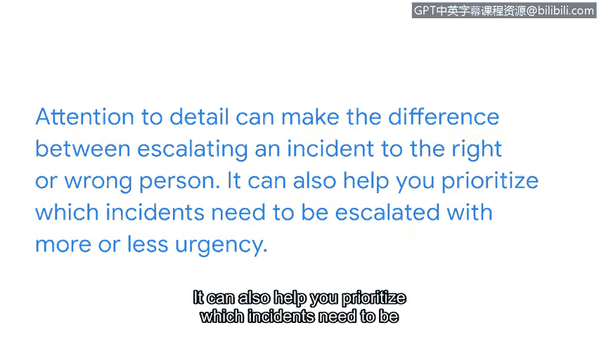

# 谷歌网络安全专业证书第八课：《投入实践：为网络安全工作做好准备》（中英字幕，前面分p中字，后面分p英字） - P53：10_02_when-and-how-to-escalate-a-security-incident.en_subtitled - GPT中英字幕课程资源 - BV12x4y1X7h8

We've shared quite a bit about the importance of your role when it comes to escalating incidents。

We've even discussed a few incident types that you may encounter。

But what are the actual steps you need to take to properly escalate an incident？

The answer to that question actually depends on the organization you're working for。

There is no set standard or process for incident escalation that all organizations use。

Every security team has their own processes and procedures when it comes to handling incidents。

In this video， we're going to discuss general guidelines for incident escalation and how to apply them on the job。

Let's get started。Each organization has its own process for handling security incidents。

That process is known as an escalation policy， which is a set of actions that outline who should be notified when an incident alert occurs and how that incident should be handled。

Ideally， the escalation process would go smoothly every time。But in the workplace。

 challenges to that process can happen unexpectedly。For example。

 what if your immediate supervisor out of office， If an incident occurs that day。

 it still needs to be escalated to someone。This is one example of why understanding your organization's escalation policy is important。

You don't need to memorize your organization's escalation policy。

 but it is wise to save a book market on your work device。This way。

 you'll always have access to it when you need it。 following an organization's escalation policy is essential because the actions you take help protect the organization and the people it serves for malicious actors。

 The escalation policy for an organization can be an extensive document。

So it's up to you to pay attention to the small details within the escalation policy of your organization。

 attention to detail can make the difference between escalating an incident to the right or wrong person。

It can also help you prioritize which incidents need to be escalated with more or less urgency。

Every organization handles incident escalation differently。

 but analysts need to ensure that incidents are handled correctly。 Great work。

 expanding your security mindset。😊。